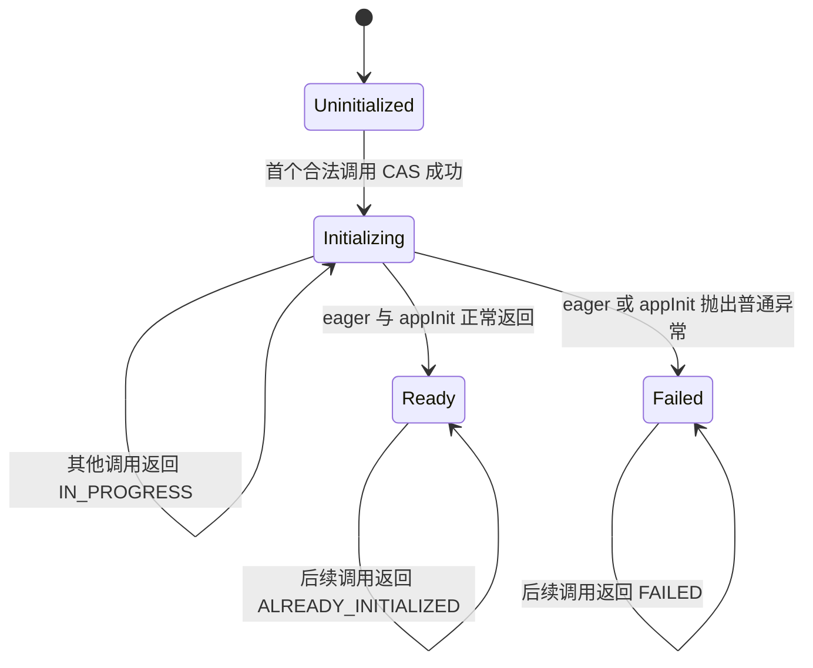

# Scoop `native-app` 动态库设计

状态：实施中。第 6 节原生函数指针合同已写入权威规范；两种指针类型和显式转换已实现，间接调用尚待完成。其余阶段仍待按实施顺序写入规范。调研依据见 [INVESTIGATION.md](INVESTIGATION.md)。设计基线为 `d2058c129e88`，日期为 2026-11-02。

## 1. 目标与边界

本设计增加一种供非 Scoop host 装载的最终产物：根 Cone、全部 Scoop 依赖、一份 runtime 与 GC 链接成单个 `.dylib`、`.so` 或 `.dll`。host 在正常装载完成后显式调用一个固定 C ABI bootstrap；bootstrap 初始化 Scoop runtime 和应用，返回后 runtime 继续存活，业务调用通过应用自定义的 C 函数表进行。

首版合同固定为：

- 每个进程只装载一个 Scoop `native-app`；该模块拥有自己的 runtime、堆、线程登记和 metadata registry；
- 只加载，不卸载；host 必须保留装载句柄直至进程结束；
- host 拥有进程入口、平台主循环和 UI 生命周期，Scoop bootstrap 必须短时返回；
- host → Scoop 使用 `ForeignCallback.function + context`，Scoop → host 使用本设计补齐的原生函数指针调用；
- 先支持现有 target，按 Darwin AArch64、Linux x86-64 GNU、其余现有桌面 target 的顺序落地；iOS、Android、HarmonyOS target 与打包后置；
- 不增加通用动态模块系统、运行期 Cone 装载、跨 Scoop 动态库 ODR、多 runtime 实例、卸载、热更新、任意函数 C 导出或 host GC 合并。

这里的单个 OS 模块仍包含多个现有 Cone logical image。Cone 依赖图、ODR、初始化顺序、TD、callable、safepoint 与 stackmap 登记继续在静态闭包内完成。

## 2. 决策摘要

| 事项 | 决策 |
| --- | --- |
| Manifest kind | 新增 `kind = "native-app"`，与 `library`、`executable` 并列 |
| Scoop 入口 | 根 Cone 中固定的 `fun appInit(hostApi: Ptr<Unit>, outAppApi: Ptr<Unit>): Unit` |
| C 导出 | 只导出 `scoop_app_init`；业务入口通过函数表返回，不按源码 `public` 导出 |
| 初始化并发 | 首个调用者执行；进行中、已成功或已失败的后续调用立即返回，不等待、不重试 |
| runtime 生命周期 | 初始化成功或普通初始化异常后均保留至进程结束；不执行 executable shutdown |
| host 线程 | bootstrap 临时 attach，返回前 detach；以后每个 callback attach-if-needed／detach-if-owned |
| 函数指针 | `FunPtr<F>` 可调用，默认 NativeSafe；新增同表示的 `GCLeafFunPtr<F>` 走 GCLeaf |
| 模式转换 | `GCLeafFunPtr` 显式降级为 `FunPtr`；反向转换必须显式 `unsafe` |
| 最终输出 | 新增 `SharedLibrary` 输出种类；与系统依赖的 `LinkMode::Static/Dynamic` 分开 |
| 可达性 | bootstrap、入口 gateway、函数表实际引用及其 metadata 作为真实根；不保留全部 public 声明 |
| 错误 | Scoop 普通异常转换为 native-owned UTF-8 报告；异常不得跨越 C frame |
| 浮点环境 | 每次 native/managed 边界保存外层状态、建立 Scoop 状态并在返回时恢复 |

## 3. 源码与 Cone 模型

### 3.1 `native-app` 根

`Cone.toml` 使用新的根种类：

```toml
schema = 1

[cone]
group = "dev.example"
name = "mobile-body"
version = "0.1.0"
kind = "native-app"
```

`native-app` 是最终产品根，不能成为另一个 Cone 的依赖。一次最终链接恰有一个 `executable` 或 `native-app` 根，其余节点必须是 `library`。普通 library 的含义及 `.slib` 分发方式不变；single-file 模式仍只生成 synthetic executable，不增加 synthetic native-app。

测试用途继续为被测 Cone 合成普通 executable entry。因此 `scoop test` 可以测试 `native-app` 的生产源码与测试源码，但测试产物不是共享库，也不调用生产 `appInit`。`[windows] subsystem` 与 `windows.rc` 首版仍只适用于 executable；DLL 资源不是动态库能力的完成前置项。

### 3.2 固定 Scoop 入口

生产 `native-app` 根必须提供：

```scoop
fun appInit(hostApi: Ptr<Unit>, outAppApi: Ptr<Unit>): Unit {
    // 校验并读取 host 函数表，构造应用状态，完整写出应用函数表。
}
```

入口规则如下：

- 必须是根 Cone 的 top-level、具名、ordinary、non-generic、non-suspend 函数，无 receiver，名称精确为 `appInit`；
- 参数必须恰为两个，展开透明 alias 后分别为实际 core 的 `Ptr<Unit>`；返回值必须为 `Unit`；
- 可以是 `internal` 或 `public`，可以按普通规则标 `@Unsafe`，但不能是 `@Extern`；
- 根中名为 `appInit` 的 top-level 入口候选必须唯一；缺失、多个候选或签名不合法均在 HIR 入口选择时给出源码诊断；依赖中的同名函数不参与选择；
- gateway 通过 typed entry identity 调用它，不从最终符号名反查源码声明，也不把它暴露为 C ABI；
- 正常返回表示应用初始化成功；需要拒绝 host 配置时抛出普通 Scoop 异常，由 bootstrap 转换为失败状态。`Int` 返回值不用于混合 runtime 状态码与应用状态码。

`hostApi` 和 `outAppApi` 均为非 null opaque pointer。`hostApi` 在协议上只读；当前 `Ptr` 不表达 C `const`，因此不写入仍是 unsafe FFI 作者的责任。应用以自己的 `@CLayout` struct 解释两个地址；编译器和 runtime 不认识业务表中的字段。应用与 host 共同维护普通 C header 及对应 Scoop 声明，本期不增加 C header 生成器。

`outAppApi` 是 host 提供的可写存储。host 只能在 `scoop_app_init` 返回 `SCOOP_APP_INIT_OK` 后读取它；失败时其中可能含部分写入，全部视为无效。入口必须在正常返回前完整初始化约定字段。长期状态通过静态根、`GcHandle` 或 `ForeignCallback` token 保活，函数表不得包含可移动 managed 裸指针。

### 3.3 eager 初始化与参数

依赖和根 Cone 的 eager initializer 仍按现有 dependency-first 顺序在 `appInit` 前执行。首版不让 eager initializer 读取 `hostApi`：host 配置只作为 `appInit` 参数可见，需要 host 的状态必须在 `appInit` 或其显式调用中建立。这避免新增全局 bootstrap 参数 API，也避免 eager 与 host 函数表发布形成隐式顺序。

`native-app` 没有进程命令行入口。现有原始参数 API 在其生命周期内固定观察到 `argc = 0`，任意 `argv(index)` 返回 null；不伪造库路径或 host executable 的 `argv[0]`。

## 4. 固定 C bootstrap ABI

工具链交付公共 `scoop_app.h`，最终共享库只导出其中的 bootstrap symbol：

```c
#ifndef SCOOP_APP_H
#define SCOOP_APP_H

#include <stdint.h>

#ifdef __cplusplus
extern "C" {
#endif

typedef struct ScoopAppError {
  const uint8_t *bytes;
  uint64_t length;
} ScoopAppError;

enum {
  SCOOP_APP_INIT_OK = 0,
  SCOOP_APP_INIT_ALREADY_INITIALIZED = 1,
  SCOOP_APP_INIT_IN_PROGRESS = 2,
  SCOOP_APP_INIT_FAILED = 3,
  SCOOP_APP_INIT_INVALID_ARGUMENT = 4,
};

int32_t scoop_app_init(const void *host_api,
                       void *out_app_api,
                       ScoopAppError *out_error);

#ifdef __cplusplus
}
#endif

#endif
```

合同如下：

- `host_api`、`out_app_api` 必须非 null；`out_error` 可以为 null，表示调用者不需要文本；非法参数在尝试启动 runtime 前返回 `SCOOP_APP_INIT_INVALID_ARGUMENT`；
- 每次调用若提供 `out_error`，bootstrap 先写成 `{NULL, 0}`；非成功状态可以返回静态文本或已复制的异常报告；
- `ScoopAppError.bytes` 是 native-owned、只读、未必以 NUL 结尾的 UTF-8 bytes，在模块保持装载的前提下有效至进程结束；host 不得释放或修改；
- `OK` 只由第一次成功初始化返回。状态已经 Ready 时返回 `ALREADY_INITIALIZED`，不会再次写出应用表；host 应保存第一次取得的表；
- 状态为 Initializing 时立即返回 `IN_PROGRESS`，包括同线程经 host 服务重入 bootstrap 的情况。bootstrap 不等待，因而不会自等待死锁，也不引入初始化条件变量；
- 初始化进入 Failed 后，后续合法调用均返回 `FAILED` 和同一份已发布报告；不重新运行 eager 或 `appInit`；
- 函数返回建立普通 C 调用顺序。Ready／Failed 状态以 release 发布，观察后续状态的调用以 acquire 读取；不会出现 Ready 但应用表尚未完成的状态。

应用自定义函数表是否携带 `size`／`version`、如何表达业务错误、buffer 由谁分配释放，属于应用自己的 C ABI。编译器不为它建立第二套版本或资格体系。

## 5. Runtime 生命周期

### 5.1 状态机

每份 `native-app` 模块包含一个私有 coordinator：



状态只协调一次初始化，不承担业务会话生命周期。Failed 不是事务回滚：已经执行的 native side effect、eager 写入、已启动线程和已注册 callback 不做通用撤销。失败时不发布 `outAppApi`，应用与 host 也不得在成功返回前把其中的入口当作可用接口。

### 5.2 coordinator 拥有的数据

当前 `scoop_rt_run_program` 的 `ScoopPlatformMetadataImages loaded` 位于栈上，而 registry 保存其地址；这不允许启动函数返回。实现时将 loaded ranges／stackmap image 的所有权移入 registry 或 module-lifetime coordinator，registry 不再借用启动栈变量。

初始化后长期存在的状态至少包括：

- 原子初始化状态与 Failed 的 native error bytes；
- `ScoopPlatformMetadataImages` 拥有的 ranges／stackmap image；
- `ScoopImageRegistry` 及其类型、callable、storage、initialization、Context key 与 stackmap 索引；
- GC、callback registry、线程 registry 和内部 collector 状态；
- 程序级 stack-trace 开关与空的原始参数集合。

这些对象不注册进程退出 destructor，也不在 Failed 或业务窗口关闭时销毁。OS 在进程结束时回收；显式业务资源仍由应用自己的关闭协议释放。

### 5.3 初始化顺序

首个合法调用按以下顺序执行：

1. CAS 将状态从 Uninitialized 改为 Initializing，保存空参数集合和最终链接选定的 stack-trace 开关；
2. 通过 runtime 内部函数地址定位**承载该 runtime 的模块**，收集它的加载范围和 stackmap；
3. 收集完整 Cone image 闭包，验证并建立现有 code/type、storage/unit 与 stackmap 索引；
4. 发布 registry，初始化线程、callback 与 GC；
5. 将当前 host 线程临时 attach，建立浮点环境 guard 和 managed gateway boundary；
6. 建立 root TaskContext，按既有顺序执行 eager gateway；
7. 调用 native-app root gateway，后者 typed 调用 `appInit` 并在离开 C 前捕获异常；
8. 正常返回时离开 managed、恢复 host 浮点环境、解除本次拥有的 attachment，再 release-publish Ready 并返回 `OK`；
9. 普通异常时先把异常类型、初始化路径和现有栈快照复制为 native bytes，完成同样的 boundary/attachment 清理，再 release-publish Failed 并返回 `FAILED`。

registry、GC 和 runtime 在步骤 8、9 之后均继续存在。普通异常报告不调用用户 `toString`，不保存 Throwable 裸地址，也不把 native unwind record 带出 managed catch。

metadata 不一致、runtime 不变量破坏、无法继续维护 GC 正确性的内部失败仍走 fatal diagnostic 与 `abort()`；内存耗尽、语言 trap／panic 及显式 `exit` 保持进程级合同。`native-app` 不把损坏的运行时状态伪装成可恢复业务错误。

`--enable-startup-stats` 若显式开启，对 native-app 只在第一次初始化报告一次既有阶段统计，统计截至 eager 完成、调用 `appInit` 前；进行中、重复和失败后的调用不产生伪造记录。未开启时仍不编入计时和报告代码。

### 5.4 入口 descriptor 与 gateway

`ExecutableEntryIdentity` 不扩成可混用的联合身份。新增独立的 `NativeAppEntryIdentity`、`NativeAppEntryPlan`、generated gateway identity、failure-root storage role 和 persistent symbol role。两种入口可以共享生成组件，但在 typed IR 中始终是不同实体。

runtime metadata 增加 `ScoopNativeAppEntryDescriptorV1`，使用独立 magic 和 gateway 函数类型：

```c
typedef uint32_t (*ScoopNativeAppEntryGatewayFnV1)(
    const void *host_api,
    void *out_app_api);
```

descriptor 保存 root Cone、源码 callable、gateway callable、failure root 和 gateway 地址。image reader 在一次 descriptor 边界验证后，把 executable/native-app 共用的 owner、callable 与 failure-root 关系规范化为 registry 内部 root view；后续 unit、依赖顺序与 storage claim 复用该结果，不在不同 stage 重放入口语义。

generated gateway 负责入口 poll、root/Context、typed Scoop ABI 调用、catch、failure root 发布和所有正常／异常出口的 Context 恢复。最终 C wrapper 只传 opaque 指针并检查 gateway status，不手写 Scoop ABI 参数布局。

### 5.5 线程、callback 与 Context

线程 registry 增加 Program 与 Embedded 两种启动模式，但不增加第二套 registry 实现：

- Program 保持现有唯一 main attachment 和 shutdown 规则；
- Embedded 允许第一个 attachment 是 bootstrap 外来线程，也允许两次 host 调用之间没有任何 mutator attachment；不会进入 ShuttingDown；
- bootstrap 返回前在没有活动 managed/root/callback frame 后 detach 自己拥有的临时 attachment；调用者原本已 attach 时只恢复嵌套状态，不拆除外层 attachment；
- 后续 `ForeignCallback` 继续使用 attach-if-needed／detach-if-owned。Reusable／OneShot token ownership 与本设计的函数指针模式无关；
- callback 注册捕获 `appInit` 当时的 Context snapshot。后续 invocation 为该 snapshot 建立独立 TaskContext，按现有规则进入和恢复；
- 模块无 unload，因此 callback code address 和 registry 不会因业务会话结束失效。应用仍须按普通 API 释放不用的 token 和 native 资源。

### 5.6 浮点环境

当前“首次 attach 时重设一次浮点环境”会永久改写 host 线程，且不能处理嵌套 native 往返。改为边界 guard：

- host → bootstrap、host → callback 及 NativeSafe callee 返回 managed 的每次外层进入都保存当前平台浮点控制状态，再建立 Scoop 的 round-to-nearest-ties-to-even、无 trap、保留 subnormal 环境；
- managed → 普通 native call 返回时重新建立 Scoop 环境，callee 对环境的修改不能泄漏进 Scoop 代码；
- callback 返回 native caller、bootstrap 正常或异常返回 host 时恢复该层保存的环境；嵌套 guard 严格 LIFO；
- Scoop 自己创建并完全拥有的线程可在线程入口建立 Scoop 环境，不需要恢复不存在的 host 状态；
- GCLeaf callee 不经过 guard，因此其 unsafe 契约增加“不得改变浮点控制环境，或必须在返回前完整恢复”。

Darwin AArch64 保存/恢复 `fenv` 与 FPCR，x86-64 保存/恢复 `fenv` 与 MXCSR；所有错误出口使用同一 guard 清理，不能只覆盖正常返回。

## 6. `FunPtr` 间接调用

### 6.1 源码类型

保留现有 `FunPtr<F>`，将它定义为默认 NativeSafe 的可调用 C code pointer；新增：

```scoop
@Intrinsic("core_gc_leaf_fun_ptr")
public struct GCLeafFunPtr<F>
```

两者的 `F` 都必须是无 receiver、非挂起、完全具体化且全部参数／结果 C-FFI-safe 的 ordinary 函数类型。物理表示都是单个 64-bit code pointer，裸值非 null，`Option` 继续使用全零 niche。

选择独立的 `GCLeafFunPtr`，而不是 `@GCLeaf FunPtr<F>`：普通类型使用注解按现行语言规则不参与类型身份、相等、泛型替换或 ABI，而调用模式必须贯穿字段、参数、返回、alias、泛型实例和 `.slib`。为一个核心注解建立相反的特殊身份规则会污染通用 type-use annotation 模型。

core 提供两个零成本 intrinsic 转换：

```scoop
@NoGC
@Intrinsic("gc_leaf_fun_ptr_as_fun_ptr")
public fun <F> GCLeafFunPtr<F>.asFunPtr(): FunPtr<F>

@NoGC
@Unsafe
@Intrinsic("fun_ptr_as_gc_leaf")
public fun <F> FunPtr<F>.asGCLeaf(): GCLeafFunPtr<F>
```

降级显式但 safe，不增加一般隐式协变或 effect subtyping；升级必须在 unsafe context 明确承担整个目标同步调用链的 GCLeaf 契约。两个转换只复制 pointer bits，不发出 runtime call。

### 6.2 调用语义

`p(args)` 与 `p.invoke(args)` 对两种 pointer 都合法：

- 调用本身是 unsafe C ABI 调用，必须位于 unsafe context；
- callee 表达式先求值且只求值一次，然后实参按现有从左到右规则各求值一次；函数类型没有默认参数、named metadata、spread 或 C varargs；
- 参数与结果按 `F` 的完整目标 C ABI 分类，支持现有定宽整数、Float/Double、pointer、enum 和 `@CLayout` aggregate；
- C/C++ 异常不得穿越该边界，返回裸 pointer 的 null 等现有 FFI 契约违例保持；
- `FunPtr` 调用发布必要 roots、进入 NativeSafe，返回时握手并重读 relocation 后引用；callee 可以阻塞，也可以经合法 `ForeignCallback` 同步重入 Scoop；
- `GCLeafFunPtr` 调用保持 Managed 状态，不建立本次 transition、safepoint 或 caller-root frame；callee 必须短时、非阻塞，不能进入 Scoop runtime／GC／safepoint、不能回调 Scoop；
- 两者继续把语言层 `GcEffect` 与 C ABI 边界模式分开。调用模式由 pointer type 决定，不能从 `@NoGC`、GC-free 参数或调用目标名称推导。

示例：

```scoop
@CLayout
struct HostApi(
    val context: Ptr<Unit>,
    val schedule: FunPtr<(Ptr<Unit>, FunPtr<(Ptr<Unit>) -> Unit>, Ptr<Unit>) -> Int>,
    val monotonicNanos: GCLeafFunPtr<() -> Long>
)

@Unsafe
fun useHost(api: HostApi, callback: ForeignCallback<(Ptr<Unit>) -> Unit>): Long {
    val accepted = api.schedule(api.context, callback.function, callback.context)
    if (accepted == 0) {
        throw IllegalStateException(Some("host rejected callback"))
    }
    return api.monotonicNanos()
}
```

### 6.3 指针来源

- native extern 返回值、`@CLayout` 字段和 pointer load 可以按声明产生任一模式；FFI 作者负责真实 native 目标遵守声明；
- `ForeignCallback.function` 保持 `FunPtr<F>`，因为调用它会进入 managed、分配或 GC；
- 现有 `::name` 静态 native callback 仍只产生 `FunPtr<F>`，并继续要求 top-level、`@NoGC`、non-generic、non-suspend、非 extern 的精确签名。即使正文为 `@NoGC`，它仍是进入 Scoop 代码的 callback，不能直接产生 `GCLeafFunPtr`；
- lambda、local function、绑定引用与 managed function value 仍不能直接构造原生 pointer；
- 不增加 pointer 地址中的模式 bit、运行期 flag 或动态分支。

### 6.4 类型与 IR 贯通

两种源码 family 在 HIR 中保存为互斥的 typed 分支，分别确定完整签名与固定模式：

```text
FunPtr(FunctionTypeId)       -> NativeSafe
GcLeafFunPtr(FunctionTypeId) -> GcLeaf
```

模式进入 exact/signature type key、类型 interner、alias 展开、generic replacement、default/template body、跨 Cone interface、MIR type、TypeInfo 和 `.slib` 指纹。C-FFI classifier 将两种模式映射到相同机器 code-pointer 类型，但类型相等和赋值不能忽略模式。显式转换在 HIR/MIR 中保存 operand 与目标模式，源／目标类型由各表达式的完整类型给出；LIR 直接复用 code-pointer operand。

MIR 增加真正的动态 C callee：

```text
NativePointerCall {
    callee: Expr,
    signature: FunctionTypeId,
    call_mode: CAbiCallMode,
}
```

它不能伪装成 managed closure、静态 extern declaration 或虚构 symbol。LIR 的 `CCallDestination` 增加 typed pointer value；ABI planner 仍生成完整 direct／sret／byval 计划，NativeSafe/GCLeaf 只选择边界协议。codegen 从实际 code pointer 发射 indirect call，并把窄整数扩展、aggregate、sret/byval、calling convention 等属性施加到 call site；不能依赖只有静态 `FunctionValue` 才能携带的 declaration attribute。

## 7. 构建、产物与 CLI

### 7.1 `.slib` 与最终产品

single-Cone 编译仍先为 `native-app` 产生完整 `.slib`。manifest summary、CompilationPurpose、entry production 和 Link view 保存新的根种类及 typed native-app entry。普通依赖仍是 library `.slib`；不增加消费另一份 Scoop `.so`／`.dylib`／`.dll` 作为语言依赖的通道。

最终链接模型增加正交枚举：

```text
FinalOutputKind = Executable | SharedLibrary
LinkMode        = Static | Dynamic
```

`FinalOutputKind` 决定 PIE/共享库、CRT 入口、导出和调试产物；`LinkMode` 只描述目标工具链允许的系统依赖方式。首版 `native-app` 的 Linux GNU／musl 只接受 Dynamic 系统模式，不能把完整静态 libc 链入任意 host；runtime 与选中的普通 static archive 仍作为模块内部对象链接。

### 7.2 命令行为

- `scoop build`：library 仍只交付 `.slib`，executable 交付程序，native-app 交付共享库；
- `scoopc build`：按单 Cone 合同产生带正确根类型的 `.slib`，不自行递归链接依赖；
- `scoop link --root-slib ...`：从 root `.slib` 推断 Executable 或 SharedLibrary，消费显式 artifact 闭包；
- `scoop run`：只接受唯一 executable。选中 native-app 时在最终链接或启动 host 前给出“需要 native host”的明确诊断；
- `scoop test`：按 3.1 合成测试 executable；`check`、`fmt`、`doc` 沿普通 Cone 处理；
- workspace 多根 build 可以同时包含 library、executable 与 native-app；单个 `-o` 仍只接受单根。

默认文件名使用 Cone name：Darwin 为 `lib<name>.dylib`，ELF 为 `lib<name>.so`，Windows 为 `<name>.dll`。显式 `-o` 使用调用者给出的实际路径，不再追加 executable 后缀。

Darwin native-app 增加最终链接选项 `--install-name`，缺省为 `@rpath/<output-basename>`；ELF 增加 `--soname`，缺省为 output basename。选项只适用于对应 SharedLibrary target，非法组合直接诊断。它们属于最终输出配置和更新输入，不进入 ConeIdentity 或语言实体身份。

### 7.3 固定导出与可达性

最终共享库动态导出集合只包含 `scoop_app_init`：

- Mach-O 使用 export list；
- ELF 使用 version script，将其他符号局部化；
- PE/COFF 使用 `.def` 或等价显式 export，并生成 host 链接需要的 import library。

Scoop/runtime/generated-C/native helper 的内部定义使用 hidden/local linkage，避免被 host 同名符号抢占；不要求 `RTLD_GLOBAL`、deep bind 或 host 提供 runtime symbol。`ForeignCallback.function` 和应用表中的函数地址通过 pointer 值传递，不需要进入动态符号表。

bootstrap 引用 native-app entry descriptor、image 数组和 runtime coordinator，形成最终选择根。entry gateway、实际 callback、TD、callable/safepoint registration、EH 与 stackmap 随真实引用保留；不以“导出全部 public”或“保留所有 Cone 代码”代替现有 reachability selection。

## 8. 平台最终链接与 self-image

### 8.1 Darwin

- 使用 `-dylib`（Clang driver 对应 `-dynamiclib`），移除 `-execute`、`-pie`、`-e _main`；
- 按 7.2 设置 install name，导出 `_scoop_app_init`，继续隐藏 `_scoop$1$*` 等内部符号；
- 保留现有 PIC、ODR、EH、dSYM 与 `__LLVM_STACKMAPS` → `__DATA_CONST,__llvm_stackmaps` 放置；
- Mach-O metadata 定位不再使用 image 0。以 runtime 内部函数地址遍历 dyld images，选择实际包含该地址的 `MH_DYLIB`；普通 executable 路径同样可用该算法选择 `MH_EXECUTE`，不维护两套解析器；
- 不在 constructor 中运行 managed 代码。dyld 和 C/C++ 静态初始化结束、bootstrap 被 host 显式调用后才启动 Scoop。

### 8.2 ELF

- 使用 `-shared`，移除 executable `-pie`、入口 CRT 与主函数假设；
- 设置 SONAME，使用 version script 仅导出 `scoop_app_init`；
- 继续用 runtime 函数地址经 `dl_iterate_phdr` 定位自身模块，实际验收 ASLR、GNU 与 musl；
- 调整现有 metadata linker script 供共享库使用，继续把 stackmap/metadata 放入可重定位后进入 RELRO 的区域；
- GNU 和 musl 产物只用于匹配的 native 环境，不互换 libc 或把静态 musl executable 配置套到 `.so`。

### 8.3 PE/COFF

- Microsoft 使用 `/DLL`，LLVM-MinGW 使用 `-shared`；移除 `wmainCRTStartup`、`-municode` 和 executable subsystem 入口；
- 只导出 `scoop_app_init`，按工具链产生 `.lib` 或 `.dll.a` import library；
- 保留 DLL 正常 CRT/TLS 初始化，但 `DllMain` 不运行 managed initializer、不开业务线程、不等待 host；
- 沿用从 runtime 函数地址取得 `HMODULE` 的 self-image 方案，实际验证 `.smap`、Win64 EH/SEH、PDB 与 callback；
- DbgHelp 等进程级设施必须与普通 host 共存后才能声明 Windows 支持；诊断能力的问题不能改写 GC/EH 正确性合同。

### 8.4 Native 依赖

所有被吸入共享库的 Scoop、generated-C、runtime 和实际 archive object 必须为 PIC 或目标 DLL 可链接形式。现有 LLVM 输出及多数 C 输入已有基础，但最终验收必须用真实 archive 发现 text relocation、重复 unwind provider、CRT 或 TLS 问题。

native C/C++ 异常必须在各自边界内捕获；Scoop 异常不得穿越 C。跨 CRT 内存由分配方释放，或使用 caller-owned buffer。普通系统 libc、unwind 和平台 framework 仍由目标工具链选择，不因“runtime 私有”而复制系统运行库。

## 9. 错误、重入与内存合同

| 边界 | 合同 |
| --- | --- |
| bootstrap 普通异常 | 转换为 `FAILED` 与 native-owned 报告；不 unwind 到 host |
| callback 普通异常 | 沿现有 token 保存首个失败；应用业务协议仍须自行表达每次调用成功/失败 |
| `outAppApi` | 仅 `OK` 后有效；失败时忽略全部内容 |
| managed 引用 | C 表中禁止未 pin、未 handle 的 managed 裸指针 |
| 同步 pointer/length | 借用到当前调用结束；异步保存必须复制、pin 或用既有 handle/token |
| 分配释放 | 分配方提供释放函数，或 caller 提供 buffer；不跨未知 allocator 直接 free |
| 普通 FunPtr 重入 | 允许 host callee 经合法 token 同步 callback；外层 roots、Context 和浮点 guard LIFO 恢复 |
| GCLeaf | 禁止回调、阻塞、runtime/GC/safepoint 与浮点状态泄漏 |
| 致命失败 | `exit`、trap/panic、runtime invariant failure 保持进程级行为 |

调用 host 函数表时，应用先把所有跨 NativeSafe 的 managed 引用放入正常 compiler/caller roots；返回后只能使用 relocation 后值。host 不得保存同步借用的 `Ptr<T>` 并在调用结束后继续访问，除非应用协议已经用 native ownership、pin 或 handle 明确延长有效期。

## 10. IR、格式与缓存变更

需要同步演进的结构包括：

| 层 | 变更 |
| --- | --- |
| manifest／PM protocol | `ConeKind::NativeApp`；根选择、dependency 限制、run 过滤与 workspace 输出 |
| identity | `RequestedConeKind::NativeApp`、独立 entry/gateway/failure-root/descriptor typed identity |
| HIR/meta | 固定入口选择；`GCLeafFunPtr` 与 pointer mode；间接调用和转换 intrinsic |
| MIR | 动态 C callee value、完整签名与 call mode |
| LIR | pointer `CCallDestination`、现有 C ABI plan、NativeSafe/GCLeaf site 选择 |
| codegen | indirect C call、call-site ABI attributes、native-app descriptor/gateway |
| `.slib` | 新根 kind、entry plan、函数指针模式、可达性请求与对应 schema/version bump |
| linker | SharedLibrary 输出、bootstrap object、固定 exports、loader name、调试／import 产物 |
| runtime metadata | native-app descriptor magic/gateway；registry 内规范化 root view |
| runtime | embedded coordinator、持久 loaded/registry、无 main attachment、错误复制、浮点 guard |

函数指针模式改变 signature/exact type identity 和跨 Cone 元数据；native-app 改变 manifest、entry production、program-link protocol、runtime metadata 及最终结果记录。项目未发布，不提供旧产物 reader、兼容 alias 或双轨格式，相关版本一次升级并要求重建。

最终结果缓存从仅 executable 的概念提升为 linked product。更新 key 至少包含：root artifact/closure、FinalOutputKind、target/profile、runtime/native inputs、bootstrap/metadata schema、固定 export 内容、install name/SONAME、stack-trace/debug 选项和实际 linker profile。默认 loader name 依赖 output basename，因此 basename 也进入 key。

更新判断仍先于源码读取、object 解包、startup 生成、工具探测与链接准备；命中且所需共享库／调试文件／import library 存在时直接复用，不读取动态库复核导出或内容。失败通过临时 candidate 保持不发布，普通并发协调和缺失输出补产沿现有机制完成。

## 11. 实施顺序

每组实现前先按第 12 节修改权威规范；同一组完成格式化、lint 和定向验证后再进入下一组。

1. **FunPtr 类型与调用闭环**
   - 增加 `GCLeafFunPtr`、显式转换、完整 typed mode；
   - HIR → MIR → LIR → codegen 打通 indirect C call；
   - 先用普通 native 函数表验证标量、浮点、aggregate、sret/byval、普通重入和 leaf 无 transition；
   - 完成跨 Cone、generic、alias、TypeInfo、`.slib` 及 negative 诊断。
2. **native-app 语义与产物模型**
   - manifest/PM/driver 加入根 kind；
   - 建立独立 entry identity、descriptor、gateway、reachability 与 artifact-only link plan；
   - CLI、默认输出、run 诊断和 linked-product 缓存闭合。
3. **Darwin AArch64 runtime 与 `.dylib`**
   - 提取 executable/embedded 共用启动步骤；
   - 持久 registry、无 main attachment、错误返回、浮点 guard、自身 image 定位；
   - 用真实 C host `dlopen`、初始化返回、多线程 callback 和 moving GC 验收。
4. **Linux x86-64 GNU `.so`**
   - `-shared`、SONAME、version script、ELF metadata/RELRO 与动态 libc/unwind；
   - 验收 host 已创建线程后装载、普通 native 依赖、阻塞 FunPtr 与 callback 重入。
5. **其余现有 target**
   - macOS x86-64 复用 Darwin；
   - Windows 三环境按各自 CRT/import library/PDB/SEH 验收；
   - musl 使用匹配的动态环境，不能因现有 static executable 默认而宣称已支持。

每个平台只有在真实 host 装载和持续调用通过后才声明支持。移动 target 与 framework/JNI/Node-API 适配在桌面合同稳定后独立设计，不反向扩张首版 bootstrap。

## 12. 规范修改清单

| 文档 | 修改内容 |
| --- | --- |
| `SCOOP-SPEC.md` 12.2～12.5 | `native-app` kind、图约束、`appInit`、空参数、测试 entry、`.slib` 与共享库区别 |
| `SCOOP-SPEC.md` 13.2、13.4.1、13.8、13.10、14.3 | 两种 pointer type、调用、转换、GCLeaf 浮点约束、unsafe/FFI-safe、ForeignCallback 保持普通模式 |
| `SCOOP-RUNTIME-SPEC.md` 2.8、3.5、4.3、4.5、5.5、6.1、7、9.4 | persistent module lifecycle、embedded attachment、错误返回、浮点 guard、Context/callback、无 shutdown |
| `SCOOP-IMPL-SPEC.md` 2.2～2.8、2.11、2.14、2.19、2.22 | typed indirect call、entry/descriptor、格式版本、SharedLibrary 输出、exports/reachability、缓存与 debug |
| `SCOOP-PACKAGE-SPEC.md` 2、3、5、7 | manifest kind、根选择、依赖限制、run/build 与 PM protocol |
| `ROADMAP.md` | 增加独立实施里程碑及分阶段支持状态，不把移动 target 写成完成门 |

设计文档不是当前语言或 runtime 合同。只有上述规范先完成一致修订后，才能开始相应生产实现。

## 13. 验收矩阵

| 领域 | 必须观察的结果 |
| --- | --- |
| 入口诊断 | 缺失、重载、receiver、generic、suspend、参数／结果错误均定位准确；dependency 同名不参与 |
| 固定导出 | C/C++ host 只看到 `scoop_app_init`；应用 callback 地址可用但不是命名导出 |
| 初始化状态 | 首次恰好一次；并发／重入立即 `IN_PROGRESS`；Ready 后 `ALREADY_INITIALIZED`；Failed 后同一报告且不重试 |
| 初始化返回 | registry/loaded ranges/静态根/Context/callback 在栈退出后不悬空；初始化线程结束不影响后续调用 |
| 双向调用 | host → callback → Scoop → 普通 FunPtr host 服务 → 同步 callback 重入，外层 roots/Context/浮点状态正确 |
| FunPtr ABI | 窄整数、Float/Double、enum、pointer、C-layout 小／大聚合、sret/byval、函数表字段与返回值匹配真实 C ABI |
| FunPtr 模式 | 默认调用有 NativeSafe transition；leaf 没有；转换、generic/alias/跨 Cone 保留模式；普通指针不自动升级 |
| GC 与阻塞 | 普通 host callee 阻塞时其他 mutator 能推进 GC；callback 分配及 minor/full 移动后引用正确 |
| 异常 | eager/appInit 普通异常返回 native bytes；callback 异常不穿 C；host 进程可继续；fatal 合同不被吞掉 |
| 浮点环境 | 非默认 host 环境在 bootstrap/callback 正常与异常返回后逐 bit 恢复；native 返回后 Scoop 环境重建；嵌套覆盖 |
| TLS/线程 | host 在线程已存在时装载；零 attachment 间隔合法；多个外来线程反复 attach/detach，无永久 main 假设 |
| 装载与 metadata | ASLR 下 self-image、EH、stackmap、TD、callable 与静态根正确；无需 `RTLD_GLOBAL` |
| 平台链接 | 实际 PIC archives、C++/unwind、CRT、RELRO/SEH、debug 文件和 Windows import library 可用 |
| CLI/缓存 | build/link 输出正确，run 明确拒绝；未变命中不准备链接，loader/export/runtime 变化正确失效，失败不发布 |
| 业务关闭 | 释放业务 token/native 资源后模块仍装载；不以 `dlclose`/`FreeLibrary` 作为验收动作 |

普通类型、转换与 API 行为优先放在所属 Cone 测试；编译错误、IR/ABI、host 装载、线程、产物、exports、CLI 和缓存使用必要 fixture。普通测试使用 release；GC stress 只用于移动 roots 与重入的定向验证，不扩成全量模式。

## 14. 不采用的方案

- **把现有 `--link-mode dynamic` 改成共享库开关**：该选项当前描述 executable 的系统链接方式，混用会让同一值同时决定 PIE 和 DSO，无法稳定进入缓存与工具链合同。
- **复用 executable `main` 与 `scoop_rt_run_program`**：它会伪造 argv、销毁 registry/GC，并把普通初始化异常变成进程退出；删除 shutdown 也不能修复栈上 loaded state 与永久 main attachment。
- **在 C constructor／`DllMain` 初始化**：loader lock、错误返回、host 配置和线程环境都不合适；只保留显式 bootstrap。
- **为每个 Scoop `public` 函数生成 C export**：Scoop ABI、泛型、managed ref、异常和可达性均不等于稳定 C ABI；首版只用固定 bootstrap 与函数表。
- **用 `@NoGC` 选择 pointer leaf 调用**：NoGC 不表达短时、非阻塞、无 callback 和无状态切换，不能替代 GCLeaf。
- **用运行期 flag 区分 pointer mode**：模式是静态 unsafe 契约且机器表示相同；动态 flag 会扩大每次调用成本并允许复制后丢失类型事实。
- **用普通 type-use `@GCLeaf FunPtr<F>`**：通用 type-use 注解明确不参与类型身份；为此建立特例会让 alias、generic、TypeInfo 与 `.slib` 有两套注解语义。独立 intrinsic family 更直接。
- **初始化失败后通用回滚或重启**：用户 initializer 的 native side effect、线程和 callback 不能由 runtime 可靠事务化；首版保留 Failed runtime 并拒绝重试。
- **通过卸载完成资源关闭**：本设计明确不卸载。业务资源必须有普通关闭协议，模块与 GC 存活到进程结束。
