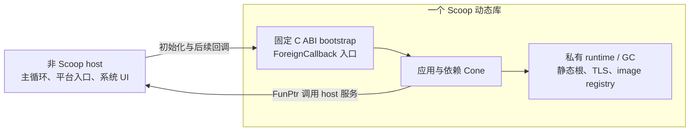

# Scoop 嵌入式动态库调研

调研日期：2026-11-02。代码基线：`d2058c129e88`。本文记录现状、建议方案与实施范围，不是已经生效的语言或 runtime 合同；本轮只做调研。

用户限定：host 由其他语言编写；每进程只加载一个 Scoop 动态库；该库拥有自己的 runtime 与 GC；只需一个或一组固定 C ABI 入口；只加载、不卸载。主要用途是移动 App 的实现主体。按后续补充，**新增 iOS／Android／HarmonyOS target 后置，先在现有 target 上实现动态库能力，并把 `FunPtr` 调用纳入方案**。

## 1. 结论与推荐形态

推荐增加一种面向原生 host 的最终产物模式，暂称 `native-app`：把根 Cone、全部 Scoop 依赖和一份 runtime 链入同一个 `.dylib`／`.so`／`.dll`，由固定 C ABI bootstrap 完成初始化，再返回 host。后续通过 C 函数表和显式 context 双向调用。



这里的“一个动态库”是一个 OS 装载模块，其中仍可有多个现有的 **Cone logical image**。现有的跨 Cone ODR、初始化顺序、TD／stackmap 登记继续在这一个静态链接闭包内完成，不需要运行期添加 Cone、跨动态库合并类型或共享 GC。

系统 libc、unwind、平台 framework 以及应用实际依赖的普通 native 库仍按目标工具链使用。runtime 私有指 Scoop 的堆、线程登记、静态状态和 metadata 归这个模块拥有，不要求把系统 C 运行库另复制一份。

主要工作集中在源码入口与产物模型、可返回的启动生命周期、`FunPtr` 的完整调用链，以及最终链接配置。LLVM 后端、对象模型和 GC 算法已有可复用基础。

## 2. 已核对的现状

| 事项 | 当前实现 | 对本任务的含义 |
| --- | --- | --- |
| 最终产物 | `RequestedConeKind` 只有 Library／Executable；program-link 要求 executable root | 需要表达嵌入式入口和共享库输出，不能只改文件后缀。见 [cone.rs](../../compiler/identity/src/cone.rs)、[program_link/graph.rs](../../compiler/slib/src/program_link/graph.rs) |
| 动态链接选项 | Linux `LinkMode::Dynamic` 使用 `-pie` | 这是动态链接的 executable，不是生成 `.so`。见 [final_link/linux.rs](../../compiler/toolchain/src/final_link/linux.rs) |
| PIC | Scoop LLVM 目标使用 `RelocMode::PIC`；非 Windows native 编译使用 `-fPIC`；Linux generated-C 也使用 `-fPIC` | 已有主要机器代码基础，不必先引入新的 LLVM relocation 模式。见 [target.rs](../../compiler/codegen/src/target.rs)、[native/command.rs](../../compiler/toolchain/src/native/command.rs)、[C 编译调用](../../compiler/toolchain/src/c_bridge_invocation/command.rs) |
| runtime 启动 | `scoop_rt_run_program` 登记 image、初始化 GC、attach main、执行 eager 与 main，随后 shutdown 并销毁 registry | 不能直接当作动态库初始化函数。见 [startup.c](../../runtime/src/startup.c) |
| foreign callback | 已有 closure handle、foreign thread attach/detach、嵌套 managed boundary、异常捕获、Context 快照 | 可以承载 host 后续进入 Scoop 的调用。见 [callback.c](../../runtime/src/callback.c)、[线程转换](../../runtime/src/thread/transitions.c) |
| Mach-O image 定位 | 固定使用 `_dyld_get_image_header(0)`，要求 `MH_EXECUTE` | 会读取 host executable，必须改成定位承载 runtime 的模块。见 [image/macho.c](../../runtime/src/platform/image/macho.c) |
| ELF／PE image 定位 | ELF 按 runtime 函数地址寻找所属 `PT_LOAD`；PE 用 `GetModuleHandleExW(FROM_ADDRESS)` | 已有定位自身模块的结构，需要实际 DSO／DLL 验收。见 [image/elf.c](../../runtime/src/platform/image/elf.c)、[image/pe.c](../../runtime/src/platform/image/pe.c) |
| 宿主线程浮点状态 | 创建 thread state 时重设浮点环境，detach 没有对应恢复 | 嵌入式边界需要保存、建立和恢复浮点环境。见 [thread.c](../../runtime/src/thread.c)、[AArch64](../../runtime/src/platform/arch/aarch64_float_environment.c)、[x86-64](../../runtime/src/platform/arch/x86_64_float_environment.c) |
| 主循环接入 | `PlatformEventLoop.attach`、`EventLoopHost`、Darwin `MainDispatchHost` 已存在 | 异步应用可以复用已有宿主接入，不必在编译器内增加调度器。见 [asyncio 规范 §11](../specs/SCOOP-ASYNCIO-SPEC.md)、[MainDispatchHost](../../sysroot/src/scoop.asyncio/platform/darwin/main_dispatch_host.scoop) |

当前登记的 target 是 macOS AArch64／x86-64、Linux x86-64 GNU／musl，以及三个 Windows x86-64 环境；事实来源是 [targets.toml](../../compiler/target-data/targets.toml)。移动 target 不在本轮前置条件和验收范围中。

## 3. 固定入口与产物模型

建议保留普通 library Cone 的 `.slib` 含义，为嵌入式根增加明确的入口分支和最终输出类别。`native-app` 只是建议名称；实现设计需要一次确定 manifest、CLI 和产物中的拼写，不建立多套入口。

固定 C ABI 可采用下面的最小形态，具体错误参数与表结构在设计阶段定稿：

```c
int32_t scoop_app_init(const void *host_api, void *out_app_api);
```

`host_api` 和 `out_app_api` 指向 host 与应用共同约定的 GC-free C 结构；函数表内包含函数指针及显式 context。bootstrap 的机器签名固定，编译器只需要处理约定的指针参数和调用状态，不需要认识窗口、网络或业务方法。表的具体声明可由普通 native header 与对应 Scoop `@CLayout` 类型表达。

建议源码侧选定一个非泛型、非挂起、无 receiver 的初始化函数，签名与固定 bootstrap 输入对应。它可以正常分配、抛出异常和注册 callback。lowering 为它生成具有入口 poll、typed 调用和 catch 的 gateway；C wrapper 不手工猜测 Scoop ABI，也不从最终符号名反查源码函数。

新入口、gateway、failure root 和 descriptor 通过现有 typed identity／IR 通道表达。可以复用当前 root gateway 的生成组成，但嵌入式初始化和 executable main 的调用形态、返回含义必须明确区分。相关位置包括 [入口身份](../../compiler/identity/src/entity/executable_entry.rs)、[LIR 入口计划](../../compiler/lir/src/production/entry.rs)、[gateway lowering](../../compiler/lir-lower/src/production/root.rs) 和 [最终 startup 生成](../../compiler/linker/src/startup.rs)。

源码 `public` 仍表示 Scoop 可见性。首版不提供任意函数的 C 导出、类导出、泛型动态导出或挂起函数 C ABI；只有 bootstrap 和确有平台要求的少量固定 native 入口进入动态导出表。通过函数表传出的 callback 地址不要求成为命名导出。

所有 native-app 仍先产生完整 `.slib`，最终共享库由独立 linker 消费静态依赖闭包生成。普通依赖仍是 library Cone；不增加“消费另一份 Scoop `.so` 作为语言依赖”的通道。`scoop build` 与独立 `scoop-link` 都应支持这一产物，`run` 对它给出需要 native host 的明确诊断。

嵌入式入口不借用 executable 的退出码或伪造 `argc/argv`。如果首版不接收命令行输入，可规定原始参数集合为空，并同步 [平台 arguments API](../../sysroot/src/scoop.platform/src/env/arguments.scoop) 的合同；host 服务、路径和应用配置通过显式参数提供。若 eager initializer 允许使用 host 配置，必须在 eager 执行前保存该 GC-free 配置，不能直到业务初始化函数中才使它可用。

## 4. runtime 生命周期与宿主边界

需要从现有 executable startup 中提取可复用的登记和初始化步骤，增加嵌入式 coordinator：

1. host 完成 OS 装载，在正常调用上下文进入 bootstrap。
2. 建立模块拥有的启动状态，保存所需的 host 输入，定位自己的装载段。
3. 登记该模块内完整的 Cone 闭包、类型、静态根、初始化单元、callable 和 stackmap。
4. 初始化 GC／线程／callback 基础状态，为本次调用建立 attachment 和 managed boundary。
5. 按既有依赖顺序执行 eager initializer，再调用应用初始化 gateway。
6. 成功后发布可用的应用函数表，离开 managed，恢复 host 状态并返回；runtime 和 GC 继续存活。

**需要改变的不仅是删除 shutdown。** 当前 `startup.c` 中的 `ScoopPlatformMetadataImages loaded` 是栈局部变量，而 [registry](../../runtime/src/image/registry.h) 保存其地址。允许 bootstrap 返回后，加载范围、registry、静态根索引等都必须有明确的模块生命周期，不能留下指向已返回栈帧的指针。

初始化线程不应被强制保留为永久 Scoop main thread。它可能是 host 的短命工作线程；本次拥有的临时 attachment 应在退出全部 managed／root／callback 清理后解除。后续入口复用 attach-if-needed／detach-if-owned，已有 attachment 的嵌套调用按 LIFO 恢复，不能拆除外层 attachment。

一次初始化可以用简单的未开始／进行中／成功／失败状态处理。重复或并发请求不能重复执行 eager；必须定义进行中返回或等待的行为，避免同线程重入等待自己。失败后不提供重启能力，不把用户 initializer 的任意副作用变成需要通用事务回滚的对象。成功前不把业务入口交给 host 使用。

以下边界需要一并明确：

| 边界 | 推荐合同 |
| --- | --- |
| 后续 host 调用 | 使用固定 gateway 或 `ForeignCallback.function + context`，进入可分配的 managed 段；不能直接调用普通 Scoop body |
| GC 保活 | callback closure 与长期应用状态使用已有 handle／静态根；C 侧不持有未固定的 managed 裸指针 |
| 参数与结果 | 使用定宽标量、C-layout 值、指针加长度、opaque context；可空指针使用对应 Option 规则 |
| 内存有效期 | 同步借用到调用结束；异步保存时复制或按现有 pin／handle 协议持有。函数表放在 host 提供的存储或明确拥有的 native 存储中 |
| 跨 allocator 释放 | 由分配方提供释放动作，或采用 caller-owned buffer；不默认允许 host 用自己的 CRT 释放库内分配 |
| 普通异常 | eager、bootstrap 和 callback 的 Scoop 异常在返回 C 前捕获；向 host 返回 GC-free 状态／复制后的错误文本，不能传递 Throwable 地址或跨 C unwind |
| callback 错误状态 | 现有 trampoline 的“异常时返回全零、token 保存首个失败”不能被误当作每次调用的成功状态；应用协议需定义返回值或错误输出，必要时在应用 callback 内捕获并转换 |
| 致命失败 | 显式 `exit`、语言 trap 和 runtime 不变量失败仍按明确的进程级合同处理；本任务不把损坏的 GC 状态包装成可恢复业务错误 |
| 浮点环境 | host → Scoop 的每次进入，包括 bootstrap 和嵌套 callback，都保存外层环境，在 managed 执行前建立 Scoop 要求的环境，所有正常／异常返回恢复；仅在首次 attach 时重设不够 |

普通初始化异常现在会经 [startup/failure.c](../../runtime/src/startup/failure.c) 调用 `scoop_rt_exit(1)`，需要为嵌入式启动分离可返回的错误处理。executable 的正常退出与失败行为保持其现有合同。

不在 C constructor、`DllMain` 或 loader lock 下运行 managed initializer、创建业务线程或等待主循环。Windows 的 CRT／TLS 正常初始化仍交给 DLL 工具链；显式 bootstrap 在 `LoadLibrary` 返回后调用。Microsoft 对 `DllMain` 的限制见资料 [4]。

“不卸载”表示 OS 模块和 runtime 存活到进程结束。host 保留装载句柄，不调用 `dlclose`／`FreeLibrary` 卸载 Scoop 模块；本次不实现 registry 注销、堆销毁或 callback 地址失效后的恢复。窗口／页面关闭、异步任务取消、文件和 GPU 资源释放仍按应用自己的正常生命周期完成，不能把这些资源都留到进程退出。

## 5. FunPtr 调用与 GCLeaf 建议

### 5.1 当前没有指针级 NoGC／GCLeaf 信息

[core 声明](../../sysroot/src/scoop.core/src/ffi.scoop) 是无字段的 `FunPtr<F>`。[HIR](../../compiler/hir/src/types.rs) 表示为 `FunPtr(FunctionTypeId)`，该函数签名保存 receiver、ordinary／suspend、参数与结果，没有 GC 调用模式。

当前 `p(args)` 和 `p.invoke(args)` 都在 HIR 明确报告 `FunPtr values are not callable in Scoop`，见 [callables.rs](../../compiler/hir-lower/src/expr/callables.rs) 和 [explicit_calls.rs](../../compiler/hir-lower/src/expr/members/explicit_calls.rs)。

`@NoGC` 标在用于生成静态 callback 的 Scoop 函数上，不会成为 `FunPtr` 值的调用属性。`@NoGC` 若用于值类型，含义是该值本身 GC-free，也不是对指针目标的描述。`@GCLeaf` 当前只允许用于 C ABI `@Extern`；[声明检查](../../compiler/hir-lower/src/annotations/functions.rs) 同时拒绝 C extern 上的 `@NoGC`。所以当前不能从一个函数指针的来源或 GC-free 表示推导无切换调用。

### 5.2 推荐两档静态调用模式

建议加入 `FunPtr` 调用，并为 native 指针增加普通／GCLeaf 两档静态调用契约，复用现有 [CAbiCallMode](../../compiler/identity/src/entity/c_call.rs)。**不建议再增加独立的 NoGC 指针档位。** 以下是语义名称，具体源码拼写尚未定稿。

| 指针模式 | callee 契约 | 调用代码 |
| --- | --- | --- |
| 普通 FunPtr，默认 | 正常 C ABI；可以阻塞，也可以经合法 callback 再进入 Scoop | 发布必要 caller roots，进入 NativeSafe；返回后握手并重读受 GC 更新的引用 |
| GCLeaf FunPtr | 同步调用链不进入 Scoop GC／safepoint、不切换 Scoop 线程状态、不回调 Scoop；短时、非阻塞 | 保持 caller 状态，不为本次调用建立 native transition／safepoint／caller root frame |

NoGC 单独说明不与 GC 交互，不能表达短时和非阻塞，也不能自动满足 release 的全部约束。它不足以选择省略切换的路径；为函数指针再加这一档会增加类型组合，却没有当前所需的第三种调用实现。即使采用 GCLeaf，实参求值中的分配、其他真实 safepoint 和指针借用仍遵守原规则。

这里应保留现有的两条维度：Scoop `GcEffect` 服务于语言的 NoGC 检查，`CAbiCallMode` 决定实际 FFI 调用边界。当前 C extern 无论普通还是 GCLeaf，在 HIR 中的 `GcEffect` 都设为 `NoGc`，但普通调用仍生成 NativeSafe transition。FunPtr 调用应沿用这一规则；不能把语言层的 `NoGc` 直接翻译为省略 native 边界，也不能据此放宽 release 的更窄检查。

GCLeaf 是**类型中的静态契约**，不在函数指针地址里编码 bit，不增加运行期标志或调用分支。两种模式的物理表示仍是一个 C code pointer，Option 的空指针 niche 不变；模式贯穿字段、参数、返回值、别名、泛型实例化和 `.slib`，不能只贴在一个局部变量上而在复制后丢失。

在其余签名完全相同时，可以允许 GCLeaf 指针值降级为普通指针值。普通指针升级为 GCLeaf 必须由明确的 unsafe 契约声明承担，不能因为参数 GC-free、名字相同或某次观察到目标函数很短而自动升级。该值转换不让 `Ptr<T>`、数组或整个可写 C-layout 结构变成协变，也不引入一般函数 effect 多态。

从 native 取得已声明为 GCLeaf 的函数表字段或返回值，其真实目标是否履行契约由 FFI 作者负责。检查是普通类型与 FFI 检查，不添加来源认证、运行期计时或调用资格证明。

`ForeignCallback.function` 保持普通模式，因为调用它会进入 managed 执行并可能分配、GC。现有 `::fn` 生成的静态 Scoop callback 也不能仅凭函数标注 `@NoGC` 就提升为 GCLeaf：现行 GCLeaf 契约明确禁止经静态 FunPtr 回调 Scoop。`ForeignCallbackMode` 的 Reusable／OneShot 管理 ownership，与这里的调用模式独立。

### 5.3 实现范围

| 层次 | 必要工作 |
| --- | --- |
| 源码／HIR | 支持 `p(args)` 与显式 `invoke`；普通 C 指针调用继续要求 unsafe。按 F 的完整签名检查参数／结果，callee 先于实参且只求值一次；不引入 C varargs、默认参数元数据或 suspend FFI |
| 类型与产物 | native 指针类型携带完整 F 与调用模式，保留现有 typed identity；默认参数正文、泛型模板、跨 Cone 类型和调用编码同步演进。模式不改变 C 机器 calling convention |
| MIR | 为 native 指针调用提供显式的动态 callee 值与完整签名／模式；不伪装成 managed closure、Scoop extern 或某个虚构 native symbol |
| ABI 规划／LIR | 将指针签名接入已有 C ABI planner；当前 `CCallDestination` 只有 `CExternFunctionRef`，需加入 typed pointer destination。按模式选择已有 NativeSafe 或 NativeGcLeaf call-site |
| codegen | 根据实际 code pointer 发射 indirect C call；复用目标完整 ABI 分类、narrow integer 扩展、aggregate 参数／返回、byval／sret 和 calling convention；相关属性必须能施加在间接调用点 |
| 优化／GC | 普通调用保留 NativeSafe 的根发布和返回协议；GCLeaf 仅省掉本次边界成本。不能把某个 leaf 来源的属性扩散到普通指针调用 |

现有实现位置：[MIR call target](../../compiler/mir/src/control_flow/calls.rs)、[LIR C destination](../../compiler/lir/src/calls/targets.rs)、[ABI planning](../../compiler/lir/src/abi/planning.rs)、[C call lowering](../../compiler/lir-lower/src/function/call/native_c.rs)、[callee 发射](../../compiler/codegen/src/function/call/callee.rs)、[C ABI 属性](../../compiler/codegen/src/function/call/c_abi.rs)、[native roots／transition](../../compiler/codegen/src/function/call/native.rs)。

完成后，Scoop 可以直接调用 host 表中的函数指针，不必为每个 host 方法写转发 C 函数。JNI、Node-API、ObjC 等平台对象的转换仍属于各自薄适配层。可选 errno 捕获不因增加普通 FunPtr 调用而自动开放新语法；是否需要由具体调用需求另定。

## 6. 最终链接、符号与缓存

输出类别必须与“系统依赖使用静态还是动态链接”分开。不要把已有 `--link-mode dynamic` 改成有时生成 PIE、有时生成共享库的隐式含义。

| 对象格式 | 共享库链接需要处理的内容 | 现有可复用部分 |
| --- | --- | --- |
| Mach-O | 原生 ld 使用 `-dylib`，Clang driver 对应 `-dynamiclib`；移除 executable 的 `-execute/-pie/-e _main`；设置实际 install name 与固定导出表；按自身 header／slide 收集 metadata | Mach-O 对象、PIC、ODR、stackmap 到 `__DATA_CONST` 的放置、系统 unwind、dSYM |
| ELF | 使用 `-shared`；不使用 executable 的 `-pie`／入口 CRT；确定 SONAME；固定 exports；沿用可重定位后进入 RELRO 的 metadata／stackmap 布局 | ELF image 自定位、`.data.rel.ro.scoop` linker script、EH、PIC、现有 native library 选择 |
| PE/COFF | Microsoft `/DLL` 或 MinGW `-shared`；移除 `wmainCRTStartup`／`-municode` 等 executable 入口配置；使用 DLL 的 CRT／TLS 初始化；显式 exports，按需输出 import library | PE 自定位、Win64 ABI、SEH、`.smap` 合并、现有目标 CRT 选择和 PDB |

对应代码：[Darwin profile](../../compiler/toolchain/src/final_link/darwin.rs)、[Linux profile](../../compiler/toolchain/src/final_link/linux.rs)、[Windows command](../../compiler/toolchain/src/final_link/windows/command.rs)、[linker 平台发射](../../compiler/linker/src/link.rs)、[ELF metadata script](../../compiler/toolchain/src/elf/dynamic.ld)。

Scoop、runtime、metadata 和内部 native helper 的定义应在该动态库内绑定，动态导出只包含固定接口；ELF 可用 version script，Mach-O 用 export list，Windows 用显式 exports／`.def`。这是普通符号可见性要求：host 可以包含其他语言的 runtime、同名 native helper 或 C++ 支持库，内部符号不能意外被它们替换。无需要求 host 用 `RTLD_GLOBAL` 或提供 Scoop runtime 符号，也不靠特殊深绑定机制解决普通链接关系。

动态导出的入口和实际传出的函数表引用需要进入现有可达性选择。被保留的 callback 正文、TD、callable／safepoint registration、EH 与 stackmap 必须随实际定义一起保留；继续复用 [selected members](../../compiler/linker/src/program/selection/reachable.rs)，不用“导出所有 public 函数”或全库强制保留代替真正引用。

Scoop、generated-C、runtime、native 对象与实际使用的 archive 都需要可用于共享库。现有 [libunwind 构建](../../scripts/build_llvm_unwind.py) 已使用 PIC 和隐藏符号，多个内置 native 库也已有 PIC 配置；仍须用实际 DSO 链接验证所选依赖，不能从 LLVM 对象的 PIC 推断所有第三方 archive 都相容。TLS 也必须支持加载时已经存在的 host 线程，不能依赖 executable 专用 TLS 假设。

GNU 和 musl 共享库分别用于匹配的 native 环境；musl 的现有默认静态 executable 配置不能直接套到 `.so`，不把完整静态 libc 塞入任意 host 来规避差异。Windows 继续使用已选 CRT，跨边界内存遵守分配方释放。Scoop 与 native C++ 的异常都在各自边界内处理，unwind provider 按现有目标合同协调。

install name、SONAME、导出列表和调试产物名必须来自最终输出配置，不能泄漏临时 candidate 路径。独立调试文件与已加载库对应；普通 release strip 不得删掉 loader、EH、stackmap 或实际导出所需内容。

新增产物种类、bootstrap／导出配置、装载名及实际 runtime/native 输入进入现有更新记录。输入未变且所需结果存在时，在读源码、解包对象、生成 startup、探测工具或准备链接之前直接复用；不读取命中动态库复核其内容。失败不发布、普通并发协调和缺失输出补产沿现有路径处理。必要的格式变更同步更新相应 schema／profile／protocol 并重建，不增加平行 reader、兼容别名或生产凭证。

## 7. 实施顺序与范围

| 顺序 | 交付内容 | 完成门 |
| --- | --- | --- |
| 1 | 先修订 spec；实现普通／GCLeaf FunPtr 类型与间接调用，并贯通共有产物 | 真实 native 函数表调用、两档边界、聚合 ABI、跨 Cone 传递与必要 negative 测试通过 |
| 2 | 在本机 macOS 打通 native-app 入口、可返回 runtime 生命周期、自身 image 定位与 `.dylib` 输出 | 普通 C host 装载后初始化返回，随后仍能调用可分配 callback，并通过移动 GC 验证 |
| 3 | 扩展到现有 Linux GNU 的 `.so`，闭合固定 exports、TLS、metadata／EH、缓存与 host 往返 | 已运行且已创建线程的 C host 能加载并持续调用；包含非 Scoop native 依赖的实际闭环通过 |
| 4 | 按复用成本补齐现有 macOS x86-64、Windows DLL 与匹配 musl 的 `.so` | 分别完成真实 host 加载验收；只对实际通过的组合声明支持 |

Windows 的普通 DLL 入口、CRT／TLS、SEH 与固定导出属于本次调查的范围；若遇到需要专门复杂适配的 host 集成，例如进程级调试设施的共同使用，不把它扩成移动主线的新前置项目。现有 [Windows 栈符号化](../../runtime/src/stack_trace/windows_symbols.c) 使用 DbgHelp 并设置其选项，DLL 场景应核对这类实际共享设施；可选诊断与 GC／EH 正确性分别评估。

主线不包含新架构 ABI、新移动 SDK 工具链、通用动态模块系统、任意函数导出、多实例 runtime、运行期新增 Cone、卸载／热更新、host GC 合并或跨 Scoop 动态库 ODR。

## 8. 移动 App 对当前设计的必要约束

虽然 target 后置，入口设计应立即适合“host 拥有主循环”的用法：bootstrap 短时返回；业务状态跨调用存在；事件在 host 选择的线程进入；后台工作通过现有 callback／任务机制投回 owner 线程。runtime 能 attach 外来线程不等于应用数据或 UI 自动具备线程安全。

可先用 C host 的队列／定时通知完成机制验收，异步应用复用 `PlatformEventLoop.attach`。当前 `scoop.window` 的桌面 Application.run 和 SurfaceHost 不是可直接嵌入任意移动 UI 的接口；之后的 UI、生命周期、输入与 surface 对接属于普通平台库／host 适配，不塞入动态库编译模式。

| 平台 | 后续交付方式与 host 适配 | 现在需要保留的设计条件 |
| --- | --- | --- |
| iOS | 动态 framework 放入 app bundle，交由 Xcode 嵌入和签名；需要分发多个平台变体时再组装 XCFramework。Swift／ObjC 壳调用 C 入口 | 支持正常依赖装载后的显式初始化，不要求任意路径 `dlopen` 或在线替换代码；install name 与导出可配置。Apple 当前文档要求 iOS 动态库以 framework bundle 交付，见 [1][2] |
| Android | 随应用交付 `.so`；Kotlin／Java 壳通过 JNI，或 native 壳直接调用 C ABI。官方 NDK sample 展示 `System.loadLibrary` 与 native 方法绑定，见 [3] | `JNIEnv`、Java 引用和 JVM 线程附着由 JNI 适配处理；Scoop attachment 不替代 JVM attachment；普通 host 方法可通过 FunPtr 表传入 |
| HarmonyOS／OpenHarmony | ArkTS 壳通过 Node-API native module 注册／导入 `.so`，适配层调用固定 C ABI | `napi_env`、`napi_value` 和引用／线程规则由适配层处理；导出一个普通 C symbol 本身不会自动成为 ArkTS 方法。OpenHarmony 官方流程见 [5][6] |

移动设备／模拟器的 SDK、target、最低系统版本、打包、页大小和各平台 native 依赖准备在后续 target 工作中完成，本次不逐项展开。OpenHarmony 资料用于确认 Node-API 接入路线，不据此承诺任意 HarmonyOS 产品版本或 SDK 的 ABI 相容性；实际目标届时按所选 SDK 验证。

## 9. 需要先修改的规范

| 文档 | 对应内容 |
| --- | --- |
| [语言规范](../specs/SCOOP-SPEC.md) §12.2、§12.4、§12.5 | native-app 根、固定初始化函数、`.slib` 与最终共享库的区别、重复初始化与命令行参数行为 |
| 语言规范 §13.2、§13.4.1、§13.8、§13.10、§14.3 | FunPtr 调用、普通／GCLeaf 静态模式、unsafe 提升／降级、C-FFI-safe 和 callback 限制；保持 NoGC 与 GCLeaf 的含义明确 |
| [runtime 规范](../specs/SCOOP-RUNTIME-SPEC.md) §2.8、§3.5、§4.3、§5.5、§6.1、第7章、§9.4 | 模块生命周期、bootstrap 可返回、self-image、临时 attachment、错误返回、浮点环境与 Context 保活 |
| [实现规范](../specs/SCOOP-IMPL-SPEC.md) §2.2～§2.8、§2.14、§2.19、§2.22 | typed 入口与 native pointer call、产物与 protocol、ABI 规划、link output kind、导出／可达性、缓存和调试产物 |
| [包管理规范](../specs/SCOOP-PACKAGE-SPEC.md)及路线图 | manifest 的新根种类／构建输出，与实际实施里程碑同步；不增加新的依赖分发体系 |

这是一项跨入口模型、调用表示、runtime 和 linker 的工作。FunPtr 的两档模式可以复用现有 C 调用协议，嵌入式 startup 可以复用现有登记与 callback 协议；工作量主要取决于这些新数据如何贯通完整 IR／产物及实际装载验证，不以修改了几条 linker flag 作为完成标准。

## 10. 建议验收矩阵

| 验收点 | 必须观察的结果 |
| --- | --- |
| 固定入口 | C／C++ host 按公开 header 编译，正常装载后取得 bootstrap；动态导出集合准确 |
| 初始化 | 依赖顺序与 exactly-once 不变；成功返回 host；重复／并发初始化遵守已定义结果，失败不发布可调用表 |
| 初始化返回后的生命周期 | 之后多次、延迟、从另一线程调用仍成功；registry、loaded ranges、静态根、Context 和 callback closure 没有悬空 |
| TLS 与 host 线程 | host 在线程已存在时加载库；初始化线程可结束；其他外来线程 attach／detach 正确 |
| 双向调用 | host → Scoop → FunPtr host 服务；普通服务可经注册 callback 同步重入 Scoop，外层 roots／Context 恢复正确 |
| FunPtr ABI | 标量、窄整数、浮点、C-layout 小／大聚合、返回值、函数表字段均使用真实 C ABI；指针只求值一次 |
| FunPtr 模式 | 默认调用保留 NativeSafe；GCLeaf 调用没有对应 transition；降级、unsafe 提升、跨 Cone 与泛型传播符合规则；不从普通指针自动推断 leaf |
| GC 与阻塞 | 普通 FunPtr callee 阻塞时其他线程仍可推进 GC；callback 分配、minor／full 移动及嵌套回调保持引用正确 |
| 语言错误 | 非法入口形态、错误 FunPtr 参数／签名、非法模式转换、缺少 unsafe 和已有 C-FFI-safe 限制有代表性位置／信息断言 |
| 异常与失败 | eager、bootstrap、业务 callback 普通异常转换为 host 可观察的错误，host 仍能继续执行；不让异常穿越 C frame |
| 宿主状态 | 非默认浮点环境下进入，返回后 host 控制状态恢复；嵌套与错误出口同样覆盖 |
| 装载与保留 | 真实共享库在 ASLR 下运行；所需 EH／stackmap／callback／TD 被保留；普通 native 依赖和现有 ODR 组合正确 |
| 构建更新 | 未变命中不重新编译／准备链接；真实源码、runtime、导出／装载配置变化正确失效；失败不发布，普通并发协调正常 |
| 应用生命周期 | 关闭业务会话与 native 资源后模块继续保持装载；不以卸载库验收资源关闭 |

普通可在 Scoop 中验证的 API／类型行为放在所属 Cone 测试。C host 装载、ABI、线程控制、产物／导出、CLI 和错误诊断使用必要的专用 fixture。普通测试使用 release；ABI／IR／跨产物所需模式组合集中在编译器正确性专测。GC stress 只用于上述移动根和重入的定向验证。

实际实施后按仓库规则先格式化与 lint，再运行相应 Rust、runtime、Cone 和正式 CLI fixture。缓存测试保留真实源码、工具和原产物，通过调用与输出验证复用。验收不增加来源审核、资源预算或重复全量语义／布局验证。

本轮未修改编译器、runtime、core 或权威 spec，也未执行动态库原型、构建或运行测试。以上现状来自规范和代码核对；实施方案与验收矩阵是后续工作的建议。

## 11. 外部资料

以下资料于 2026-11-02 读取。Apple 当前文档与归档技术说明共同支持 framework 交付结论；Android 使用官方 NDK sample 确认现有装载方式；Harmony 部分使用 OpenHarmony 官方文档。外部资料只用于平台装载与互操作事实。

1. [Apple：Creating a multiplatform binary framework bundle](https://developer.apple.com/documentation/xcode/creating-a-multi-platform-binary-framework-bundle)。明确说明 iOS 等平台的动态链接需要 `.framework`，XCFramework 中独立 `.dylib` 的动态链接面向 macOS。
2. [Apple TN2435：Embedding Frameworks In An App](https://developer.apple.com/library/archive/technotes/tn2435/_index.html)。描述 framework 嵌入与签名，并说明 iOS 不支持直接嵌入普通独立 `.dylib`。应用随包交付代码的约束另见 [App Review Guidelines §2.5.2](https://developer.apple.com/app-store/review/guidelines/#software-requirements)。
3. [Android 官方 NDK hello-jni sample](https://github.com/android/ndk-samples/blob/main/hello-jni/app/src/main/java/com/example/hellojni/HelloJni.kt)。包含 `System.loadLibrary("hello-jni")` 和 Kotlin native 方法声明。
4. [Microsoft：Dynamic-Link Library Best Practices](https://learn.microsoft.com/en-us/windows/win32/dlls/dynamic-link-library-best-practices)。说明 loader lock、DllMain 的限制和延后复杂初始化的要求。
5. [OpenHarmony：Node-API 简介](https://github.com/openharmony/docs/blob/master/zh-cn/application-dev/napi/napi-introduction.md)。说明 ArkTS 导入时装载 `.so`／依赖、注册 exports 以及后续调用流程。
6. [OpenHarmony：静态方式加载 Native 模块](https://github.com/openharmony/docs/blob/master/zh-cn/application-dev/arkts-utils/arkts-import-native-module.md)及 [NDK 工程构建概述](https://github.com/openharmony/docs/blob/master/zh-cn/application-dev/napi/build-with-ndk-overview.md)。给出 `.so` 导入和独立目标工具链的使用方式。
