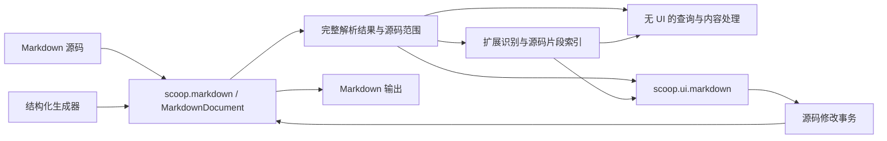

# 独立 Markdown 文档库设计

日期：2026-11-15。状态：实现已暂停，本次更新扩展设计，进度见 [实施记录](PROGRESS.md)。本文定义独立的 `scoop.markdown` Cone；编辑器见 [Markdown 编辑器设计](../ui/markdown/DESIGN.md)。文中的名称和签名是拟议 API，不代表当前 sysroot 已提供。

## 1. 目标与分层

`scoop.markdown` 提供可以独立使用的 Markdown 文档能力：解析文件内容、查询结构、按源码或结构修改、处理扩展、生成 Markdown。命令行、文档生成器、静态站点工具与 UI 编辑器使用同一份模型。

| 层 | 职责 | 依赖边界 |
| --- | --- | --- |
| `scoop.markdown` | 源文档、解析结果、结构查询、事务修改、生成、扩展语法与内容处理 | 纯 Scoop，依赖 core／std；不依赖 UI、window、graphics、编译器 stage 或 LLVM |
| `scoop.ui.markdown` | 源码、所见即所得、双栏编辑；选区、撤销、IME、布局、主题、扩展展示 | markdown、ui、graphics.text 及实际使用的控件／样式 |
| 应用提供的适配 | 文件读写、资源定位、外部图像渲染、打开链接／被包含文件 | 由应用选择 platform、asyncio 或第三方库 |

本轮只交付文档核心与扩展框架，范围以[编辑器设计 §1.1](../ui/markdown/DESIGN.md#11-本轮交付边界)为准。具体扩展按需后续增加，不因本文列出某种语法就要求本轮实现；已有公式、Mermaid 与 mdBook 能力保留并可作为接口验证参考。具体外部工具和图像解码不进入文档层的必需依赖，也不因每一种语法新增一个 Cone。

扩展分为 Inline 与 Block 两种形态。文档层通过统一识别入口提供带源码范围的扩展片段，保存语法、语义数据和上下文；UI Cone 据此选择展示并管理原位源码编辑。同一内容可有行内和块展示方式，已有 CodeBlock／Image 保持标准节点。框架提供足够的接入抽象，应用注册所需的识别规则、内容处理与展示适配；本轮不逐个补齐 Typora 扩展或第三方兼容。



本设计沿普通 Scoop Cone 和库 API 实现，不改变 Scoop 语言语义、编译流水线或 runtime ABI。字符串与位置遵守[语言规范 §11.4](../specs/SCOOP-SPEC.md#114-string)的 UTF-8 合同；共享快照沿语言的普通并发与 GC 合同，不增加 native 数据后端。

## 2. Markdown 源码是唯一可写文档

文档保留原始 UTF-8 文本。解析树、预览、图片、目录和扩展展开结果都是派生数据，不形成另一份可写正文。

这决定了三个基础行为：

1. 读入后未经编辑，输出与输入逐字节相同，包括 CRLF／LF、空白、引用式链接、强调符号、代码围栏及未知扩展。
2. 编辑修改明确的源码范围。修改一处标题不重排其他段落，不重编号其他列表，不将引用式链接改为行内链接。
3. 新建文档和新插入节点由生成器选择合法 Markdown 写法；只有显式格式化才规范化已有内容。

语义树不必把每个空白都建成对象。源码 buffer 持有所有字节；节点的完整范围、正文范围、必要分隔符范围与未解释片段共同保留可逆信息。不能仅凭语义 AST 重新序列化整篇文档来实现一次编辑。

文件编码转换属于 IO 适配。文档层接收合法 UTF-8，不隐式替换非法输入或做 Unicode normalization；若应用需要读入其他编码，先使用字符集库。BOM、换行及末尾换行的保留策略由输入／输出选项明确指定，默认保留已读入内容。

语义片段使用 `MarkdownSyntax.exportMarkdown(sourceRange)` 和 `replaceMarkdown(sourceRange, markdown)`，适用于无 UI 消费者。导出只规范化所选片段，补齐样式、引用目标与脚注；插入复用现有删除规则、容器和表格写入，冲突脚注一起重命名。准备结果 MarkdownFragmentEdit 带单次 change、源码 selection 和已解析的局部 after；发布边界不重复解析。具体可用行为以 [片段规范](../specs/SCOOP-MARKDOWN-SPEC.md#86-markdown-片段导出与插入)为准。

## 3. 公共数据模型

### 3.1 文档、快照与解析结果

| 类型 | 含义 |
| --- | --- |
| `MarkdownDocument` | 可变的源文本、文档身份、单调内容 revision，以及可复用的解析结果；修改由一个 owner 串行执行 |
| `MarkdownSnapshot` | 不可变源文本快照、revision、行索引和范围读取；可以经正常同步交给工作线程 |
| `ParsedMarkdown` | 与一个 snapshot 精确对应的完整语法树、引用定义、诊断和源码映射 |
| `MarkdownRegion`／`ParsedMarkdownRegion` | 保留原文档身份的局部源码区域及其明确的局部树；沿差量推进后按需解析 |
| `MarkdownNode` | 已识别的节点种类、子节点、完整源码范围、正文及分隔符位置 |
| `MarkdownExtensionSpan` | 一次扩展出现的名称、Inline／Block 形态、语法节点、完整源码范围、语义数据及来源映射；是原语法的结构视图 |
| `MarkdownExtensionIndex` | 与解析结果和 profile 对应的扩展片段索引；支持按源码位置、相交范围与语法节点查询 |
| `MarkdownChange` | 同一基线上的替换集合、前后 revision、位置映射及需要的逆向修改数据 |

`MarkdownDocument` 不持有 UI State、焦点、选区、IME 或撤销栈。编辑器把 `MarkdownChange` 纳入自己的统一历史；无 UI 程序可以只处理修改结果。

文档提供普通内容差量订阅，一次成功事务发布后通知一次；回调消费不可变 change，不在通知栈中重入修改。该接口不依赖 UI，也不建立通用消息总线。`MarkdownEditorState` 据此更新选区、派生状态和历史归属；程序化修改不会成为 UI 察觉不到的第二条写入路径。整体重新载入使用明确的 reset 操作，由编辑器重置旧历史。

读取源文本与读取解析结构分别表达：`snapshot()` 不隐式触发全文解析；`parse()` 返回匹配快照的完整 `ParsedMarkdown`，必要时同步完成解析。UI 显式在后台调用同一解析入口，不能通过读取 `document.root` 意外在输入线程进行重解析。树中的必要结构不以未填充的 Option 或等待下游补全的占位节点表达。

需要连续块编辑时，从完整解析的 `region(range)` 取得包含完整顶层块与邻接上下文的区域。`region.after(change)` 只推进快照与外部定义映射，`region.parse()` 再显式构造局部树；完整与局部树共用 `MarkdownSyntax` 的查询和结构事务。区域坐标始终是原文档坐标，不建立独立文档或历史。区域编辑必须保持区外块边界，任意源码修改的跨块影响仍由完整后台解析处理，详见[文档规范 §6.1](../specs/SCOOP-MARKDOWN-SPEC.md#61-局部结构区域)。

拟议核心入口：

```text
MarkdownDocument.fromText(source, profile): MarkdownDocument
MarkdownDocument.snapshot(): MarkdownSnapshot
MarkdownDocument.parse(): ParsedMarkdown
parseMarkdown(snapshot, profile): ParsedMarkdown

MarkdownSnapshot.read(range): String
MarkdownSnapshot.chunks(range): chunk iterator
MarkdownSnapshot.byteLength: Long
MarkdownSnapshot.positionOfLine(line): MarkdownPosition

MarkdownDocument.apply(edit): MarkdownChange
MarkdownDocument.transform(parsed, operations): MarkdownChange
MarkdownDocument.writeTo(writer): Unit
MarkdownDocument.toMarkdown(): String
markdownDocument(configure): MarkdownDocument
```

`toMarkdown()` 是显式全文物化；绘制、选区移动、局部编辑和后台任务入队不调用它。`writeTo` 顺序消费片段，不要求先拼成完整 String。解析函数在后台消费快照的分块读取，不要求 UI 线程物化全文。

### 3.2 位置与节点身份

文档位置采用独立的 `MarkdownPosition`／`MarkdownRange`，单位为 Long UTF-8 字节，范围为半开区间，端点必须在 Unicode 标量边界。无 UI 库不导入 `scoop.window.Utf8Range` 或 `scoop.graphics.text.TextPosition`；UI 适配负责类型转换与视觉 affinity。

节点引用使用类型化 `MarkdownNodeId` 和所属文档／解析 revision，不用标题文字、数组下标或 FQN 充当身份。源位置平移不改变可确认仍是同一节点的身份；结构改变导致拆分、合并或种类变化时，生成相应新节点。不存在的或过期的节点引用作为普通参数／状态错误处理。

跨 revision 的长期位置采用 `MarkdownAnchor(position, bias)`；插入点之前／之后的偏向决定同点插入后的归属。删除覆盖的位置收敛到替换边界。它服务书签、诊断与 UI 位置恢复，不为每个字节分配身份。

### 3.3 节点覆盖

核心节点包含 document、paragraph、heading、blockquote、list／list item、task item、thematic break、fenced／indented code、table／row／cell、reference definition，以及 text、emphasis、strong、strike、code span、link、image、break 等行内节点；CommonMark 的 HTML 保留为原始内容。已有 footnote definition／reference 等节点继续可用，不因列入模型就扩充相关语法。

数学内容、front matter、HTML 和自定义指令可以保存为明确的扩展／原始内容节点。Mermaid 的源码仍是带 `mermaid` info string 的 fenced code；注册展示扩展不改变其 Markdown 存储形态。

错误或尚未输入完整的语法保留为 parser 能确定的普通文本、未闭合结构或扩展错误节点。解析不能因为缺少公式／Mermaid 渲染工具而失败。

## 4. 源码事务与结构化处理

### 4.1 一次修改只有一个发布点

`MarkdownEdit` 包含基线 revision 和按同一基线定义的有序、不重叠替换。入口核对实际范围、编码边界和版本后原子发布，失败不留下半篇新文本。位置映射、逆向修改和解析失效信息复用同一批差量。

结构化操作在完整或局部的 `MarkdownSyntax` 上定位，再编译为同样的源码替换：修改标题级别、替换文字、增加／去掉标记、插入／移除节点、改变列表层级、修改链接目标、修改表格单元格／行列。它们与 UI 的源码输入没有第二条写入路径。

结构操作要求其依赖的解析结果仍适用。首期拒绝过期结果，由调用方重新取得当前解析；不按旧节点偏移直接改新文档，也不因一次改写重新验证所有未变化的节点。

`MarkdownSyntax.splitBlock`／`joinBlocks` 返回 `MarkdownBlockEdit`，将块操作和结果源码光标准备为一次事务。它们可由无 UI 程序直接 applyTo，也可交给编辑器共享历史；拆分继承列表和引用容器，合并只接受同容器的相邻段落／标题。具体字节、空标题、任务及编号规则见[文档规范 §8.4](../specs/SCOOP-MARKDOWN-SPEC.md#84-块拆分与合并)。

`MarkdownSyntax.textContent(sourceRange)` 提供跨块的 `MarkdownTextContent`，将真实显示文字与结构分隔映射到源码；replaceText 和顺序编辑批次返回一次 `MarkdownTextEdit`。同容器段落／同级列表项合并，不同容器和表格网格保留边界；恢复可跨越多个原始块，输入法和无 UI 消费者共用这套文档操作。完整规则见[文档规范 §8.5](../specs/SCOOP-MARKDOWN-SPEC.md#85-多块显示内容的编辑)。

### 4.2 必须解决的写回细节

- 改写强调或代码 span 时处理转义和分隔符冲突；新建代码围栏长于正文中相同字符的最长相关连续串。
- 列表缩进、引用前缀、紧凑／宽松列表及续行由所属容器规则决定，不能只在当前行前拼固定空格。
- 修改表格保留没有改动的单元格源码；新增行列生成必要的 `|` 和分隔行。单元格中的 `|`、反斜杠和 code span 按 Markdown 规则处理。显式对齐表格才重排整个表格的空白。
- 修改引用式链接的显示文字保持原目标；可直接保留原有写法时复用源码。跨节点语义重建或块拆分需要独立链接时生成 inline target；共享定义仅由明确命令修改。
- 跨行内节点的格式化可以拆分／合并当前范围的标记；跨段落操作按块分别处理，不能生成跨块的错误强调结构。
- `MarkdownTextContent.setStyle` 对非空显示范围准备跨块粗体、斜体和删除线修改，保留代码／扩展原子与容器网格；`styleState` 汇总 Off／On／Mixed／Unavailable。同批新文字的格式修改保留 insertedRange，取消或反向事务恢复确切源码。折叠光标的后续输入样式属于编辑会话，不向文档提前写入空标记。
- `setCode`／`codeState` 独立处理代码 span，跨块时保留换行、容器与原子对象；replaceText 的可选 code 控制新文字模式，在规范化前生效。行内 setLink／removeLink 修改显示选区的链接归属，replaceImage 插入或替换一个映射对象，生成直接目标并保留共享定义。所有操作准备普通源码事务，独立文档 Cone 不读取图像资源。
- 用户输入使语法变为暂时不完整时仍保存输入；结构化命令只能作用于当前能可靠识别的部分。

### 4.3 全文源码搜索

`MarkdownSearchQuery` 表达字面／正则、大小写及整词选项；`snapshot.search(query)` 显式扫描原始 Markdown，不需要语法树或 UI。复用 scoop.regex 的 Unicode 匹配，正则默认多行锚点；结果只公开 UTF-8 源码范围，支持循环导航和先二分定位的相交迭代。零宽匹配沿正则引擎的前进规则处理，空查询返回空结果。

`MarkdownSearchResult` 保留被搜索的不可变 snapshot；`prepareReplace`／`prepareReplaceAll` 将原匹配集合变成普通 MarkdownChange，沿现有检查和发布边界应用，提供精确 inverse。正则捕获模板在准备阶段展开，普通替换按字面处理。搜索作为显式全文工作可由调用方放到后台，UI 接入复用这份结果和文档事务，不另设内容副本或历史。

### 4.4 标题索引与导航

`ParsedMarkdown.navigation()` 显式生成绑定快照的 `MarkdownNavigation`。正文 ATX／Setext 标题按源码顺序保存解码标题、稳定规则产生的唯一锚点、父标题及章节范围；排除代码、HTML、扩展正文和脚注定义内部的标题。脚注定义／引用锚点与标题使用同一命名表。索引不触发 I/O 或修改正文，`resolveLink` 只解析本文件 fragment，`tableOfContents` 使用现有生成 DSL 输出独立 Markdown 列表。

`positionAt(line, column)` 与 `lineColumn(position)` 提供物理行／Unicode 标量列和 UTF-8 字节坐标的转换；参数从零计数，列越过行正文时停在行尾。独立程序可复用它们做批处理定位。Editor profile 的 `tableOfContentsDirective()` 识别独占一行的 [TOC]，保留源码；目录只在调用方明确生成或 UI 最终预览投影中派生。

### 4.5 编辑器折叠

UI 在后台从原语法和导航章节范围建立 `MarkdownFoldIndex`，保留完整标题、代码围栏首行与 front matter 首行。`MarkdownFoldingController` 保存每个视图的折叠状态，两栏共享源范围；代码只在源码栏折叠，预览图像块仍走既有扩展展示。按钮与 `markdownFoldingToolbar` 使用同一控制器，折叠不生成正文历史。

布局保留展开时的持久高度树，再以整段零高度投影隐藏物理行或显示块；可见行查询跳过隐藏子树。显示行按单调源码区间建立索引，处理文末脚注、include 和局部编辑行片段，避免折叠大段正文时逐行扫描。跳转／搜索和程序化光标展开目标祖先，键盘跨行移动跳过隐藏区；光标删除将跨过隐藏内容时先展开，显式跨区选区仍操作完整正文。IME 组合范围不能被收起；过期命中和帧不能改变新折叠布局。

## 5. 从结构生成 Markdown

生成器提供 document／block／inline builder，使用普通 Scoop receiver DSL。生成器是无 UI API，不复用 `StyledText` 或组件描述。

```text
val doc = markdownDocument {
    heading(1) { text("发布说明") }
    paragraph {
        text("当前版本支持 ")
        strong { text("独立文档处理") }
        text("。")
    }
    bulletList {
        item { paragraph { text("读取 Markdown") } }
        item { paragraph { text("生成 Markdown") } }
    }
    fencedCode(language = "mermaid", body = "flowchart LR\n  A --> B\n")
}
doc.writeTo(writer)
```

以上仅示意拟议 DSL。`text` 将内容作为普通文字并正确转义；`rawMarkdown` 明确插入调用方提供的 Markdown；二者不能靠猜测混用。表格 builder 提供行／单元格，代码 builder 选择正确围栏，链接／图片 builder 负责目标和标题的引用形式。

默认输出模式为 `PreserveSource`。生成的新节点采用配置的换行、缩进、列表符和强调符；替换已有节点时优先继承所在容器的必要写法。显式 `format(options)` 才允许全局规范化，未知扩展的原始内容仍原样保存。格式化不是保存和切换编辑模式的副作用。

内存中的源文档输出与扩展展开输出明确区分。构建工具若需要把 include 的内容写入最终 Markdown，显式取得处理后的文档再输出；原始 `MarkdownDocument` 不因此被改写。

### 5.1 HTML 导入

本节记录已经完成的辅助能力。本轮保留现状，不继续增加 HTML／CSS 转换范围，也不将 HTML 导入作为核心或扩展框架的新增交付项。

独立 `importMarkdownHtml` 接受 HTML 字符串与 `MarkdownHtmlImportOptions`，返回新 Markdown、原 HTML 片段范围和诊断；不依赖窗口或图形库。常见段落、格式、列表、代码及普通矩形表格复用现有 Markdown 生成器。无法表示的结构与未知元素保留原始 HTML，样式只转换明确支持的文字语义，不构造浏览器布局或执行脚本。完整转换范围、HTML 实体／空白规则和恢复边界以 [文档规范 §7.1](../specs/SCOOP-MARKDOWN-SPEC.md#71-html-导入) 为准。

导入只转换调用方提供的片段，生成结果可直接保存，或交给已有 `replaceMarkdown` 准备一次语义事务。UI 剪贴板使用同一入口并遵守当前 profile；原始文档的其余内容、保存与撤销规则保持不变。

## 6. 扩展语法与无 UI 处理

### 6.1 按具体语法接入

“从 Markdown 中分离扩展”是在同一份源文档上建立可查询的结构视图。扩展片段不持有另一份可写正文；编辑与保存仍使用原文档的范围和事务。识别属于独立文档 Cone，UI 不扫描全文猜测图片、围栏或指令的边界。

#### 6.1.1 两种识别入口

扩展使用普通静态库对象注册到 `MarkdownProfile`。每项指定稳定名称、允许上下文和识别规则；标准语法与新增语法使用不同入口，最终均产生 `MarkdownExtensionSpan`。

| 入口 | 输入与职责 | 例子 |
| --- | --- | --- |
| 标准节点匹配 | parser 先按 Markdown 规则产生节点，注册规则按节点种类、语言、info／参数和容器上下文选择扩展，复用既有语义与源码映射 | Image → 图片；带 `mermaid` language 的 fenced CodeBlock → Mermaid；其余 CodeBlock → 原生代码展示 |
| 新增语法识别 | 在合法的行内或块上下文识别定界符、正文与参数，产生扩展语法节点，再输出同样的片段 | 行内／块公式、`{{#include ...}}`、应用定义的多行块 |

例如 `` 和引用式图片均先由图片语法解析，再触发图片扩展；扩展不重复解析方括号、转义、目标或 title。Mermaid 规则只匹配 fenced CodeBlock 的语言信息，消费完整 info 与正文；普通代码回退规则排在其后，未知语言仍按代码展示。注册展示不会把这些标准节点替换成另一套扩展树。

同一个扩展可以有多条规则，覆盖 Inline 与 Block。片段形态描述它在 Markdown 内容中的位置，不包含 UI 尺寸或资源：行内公式位于段落中，围栏代码独立成块。图片默认沿行内位置；当它是段落中唯一有意义的内容且 profile 选择块展示时，片段可标为 Block，标准 Image 节点和源码仍保持原样。

规则顺序在 profile 中显式确定，同一入口按顺序选择第一个成功匹配；具体的语言／参数规则放在通用回退前。同一出现位置只有一个选中的展示扩展，不能依赖映射容器的遍历顺序。上下文允许的嵌套片段可保留父子关系，不允许两个互不包含的片段交叉占用源码。

#### 6.1.2 统一片段与源码索引

以下是拟议数据合同，实际名称和签名随实施写入规范：

| 片段信息 | 合同 |
| --- | --- |
| 扩展名称与形态 | 稳定的扩展名称和 Inline／Block；同名的不同出现各自保留位置 |
| 所属语法 | 所属 parsed snapshot 与类型化节点引用；标准节点直接引用现有 Image／CodeBlock，新语法引用其 Extension 节点 |
| `sourceRange` | 原文档 Long UTF-8 半开区间，包含本次语法的定界符、围栏或指令；用于进入源码编辑、替换与定位 |
| 语义数据与映射 | 复用节点的正文、目标、参数等结构化数据；解码后的值保留回原文的分段映射，不假设所有内容都是一个连续 body |
| 完整性与诊断 | 是否闭合、当前可确定的范围及诊断；编辑中的不完整输入仍能无损保留 |
| 实际依赖 | 使用到的引用定义等语法依赖；资源展开与渲染另行报告实际读取的资源和配置 |

图片尤其不能简化为一个正文字符串：alt、URI 与 title 位于不同源位置，alt 可以包含行内结构；引用式图片的 URI／title 可以来自别处的定义。片段的 `sourceRange` 只表示当前图片使用点，引用定义通过语义依赖和各自映射关联。编辑当前图片不因此吞入定义到使用点之间的整段文档。代码正文去除容器前缀后的文本同样保留原始映射。

`MarkdownExtensionIndex` 随匹配的解析结果建立，按位置返回包含它的片段，按范围返回相交片段，并可由节点查询。嵌套时返回关系明确的候选，由 UI 选择当前可见的最内层入口。查询使用有序范围／嵌套索引，不在光标移动或每一帧扫描全文，也不物化完整 String。

索引只说明所属快照的语法，不能直接把旧范围用于新正文。文档差量可推进未变化片段的位置；受影响部分需重新识别。编辑器中已激活的源码区域另用 `MarkdownAnchor` 随差量维护，不能因解析暂时不再识别该扩展就丢失输入，交互规则见[编辑器设计 §8.2](../ui/markdown/DESIGN.md#82-源码与显示的交互)。

#### 6.1.3 解析器需要提供的接入点

标准节点路由发生在相应语法与引用目标已解析后。新增行内规则在允许的词法位置接入；转义、code span、HTML 等既有上下文优先，普通代码正文默认不识别其他扩展。规则读取带映射的原文，指令参数不能被后续强调等行内结构拆断。不能对原始全文做一次正则提取后再拼回 Markdown。

新增块规则需要明确开始、继续与结束条件，并在块解析确定段落分界前参与当前容器的判断，支持跨多行及包含空行的正文。parser 负责列表缩进、引用前缀、围栏长度、容器结束与 UTF-8 边界；扩展只判断其自有语法。规则须声明是否可打断段落、是否继续解析内部 Markdown，以及未闭合时在容器边界或文档末尾的恢复方式。单个定界块不能吞掉容器外内容；需要跨容器改写文档结构的模板继续由带来源映射的 processor 处理后重新解析。

当前 `MarkdownExtensionLocation.Code` 是明确允许在代码正文匹配指令的语法上下文，不是第三种展示形态。例如 fence 内的 mdBook include 只有显式启用才识别，其他代码中的 `$` 或花括号保持普通代码。这样的子片段仍复用 Inline／Block 形态与来源映射；正文按代码或 Markdown 展开由处理上下文决定。

当前实现已有标准 Image／CodeBlock、映射文本和自定义匹配基础，但自定义 Block 主要接管 CommonMark 之后已确定的整个段落。标准节点的统一路由、片段索引及上述多行块接入点属于本次设计要求，尚未交付；不能用单段落后处理代替它们。

语法识别不要求内容处理或图像渲染。`MarkdownProcessor` 提供可选的展开，renderer 位于 UI／应用适配层；没有 renderer 的 headless 程序仍可查询图片、代码与自定义扩展，处理或生成原始 Markdown。不新增动态插件装载、脚本权限或编译器插件机制。

### 6.2 处理结果与来源映射

处理器消费扩展片段对应的不可变语法与语义数据、文档 base URI、调用方的资源 resolver 和本次配置。识别、展开和展示分别可用；解析本身不读取 include 文件、不执行外部工具、不下载图片。

处理结果为普通数据，至少覆盖：

- 保持原始节点与其语义数据；
- 带来源信息的 Markdown 片段；
- 当前代码块内的纯文本片段；
- 与源范围关联的诊断。

展开内容记录 `GeneratedFrom(directiveRange, resourceUri, resourceRange?)`。缺少细粒度映射时，只映射到整个指令范围，不能假装生成内容的第 n 个字节等于原文件的第 n 个字节。UI 对生成内容默认只读，可以定位指令或请求打开被包含文件。

处理器报告实际读取的资源和配置变化依据。输入没有变化时复用结果；文件通知或应用提供的新 revision 触发重处理。循环 include、缺失文件、无效行号／anchor 等按当前操作报告，不增加通用资源计费或文件系统来源审计。

### 6.3 mdBook 风格扩展

本节以已经实现的 mdBook include 说明语法识别、资源处理与来源映射如何组合；它是框架的实际使用参考，不是本轮新增命令或兼容完整 mdBook 的任务。已有示例包括：

```text
{{#include chapter.md}}
{{#include example.rs:2:10}}
{{#include example.rs:sample}}
```

路径相对包含该指令的源文件解析；include 出来的文档继续保留自己的 base URI。行范围使用 mdBook 的一基行号和包含式末行，并支持单行、开放起点和开放终点写法；anchor 按成对标记选取内容，忽略应被省略的 anchor 标记行。

普通 Markdown 中的 include 展开为同一位置／容器上下文里的 Markdown；代码围栏内展开为该代码块的文本。展开产生的 Markdown 必须在插入后的语法上下文中解析，不能把每个 include 独立解析后简单拼 AST。例如它可能贡献列表续行、表格行或代码块内容。需要时以整个所在容器、乃至文档作为派生解析单元，同时保留分段来源映射；这不改变原始源码树。

未注册的指令保留源码并可报告缺少处理器；注册后处理失败保留源码与错误。`rustdoc_include` 等隐藏行规则需要各自明确处理，不把普通 include 改名后就声称兼容。

将来若需兼容 mdBook preprocessor，由应用适配按官方 `[context, book]` JSON 协议运行相应程序，把返回内容作为派生文档；本轮不实现这套兼容层。协议本身没有提供可靠的逐字来源映射，返回内容也可能依赖其他章节，因此无映射时使用文档／章节级预览与定位。`scoop.markdown` 不假设任意 mdBook 插件都等价于局部模板替换。

## 7. 实现选择与性能边界

### 7.1 纯 Scoop 实现

按实现阶段的用户要求，文档库全部使用 Scoop，不新增 Rust／C 后端，不链接 Ropey 或 pulldown-cmark。原始调研中的两个库只作为算法和行为参考。源文本采用不可变、平衡的分块文本树，修改只复制相关路径与有界叶片；快照共享原有子树，节点保存字节长度和换行汇总。

解析器以 CommonMark 0.31.2 为语义基础，使用块容器与行内 delimiter stack 的常见算法，覆盖本轮常用 GFM 能力并提供 §6.1 的扩展接入点。文中的具体扩展示例不扩大 parser 的内置语法清单。实现参考成熟的 [commonmark.js](https://github.com/commonmark/commonmark.js) 和规范用例；实际移植代码时保留来源与许可，不能通过调用外部 Markdown 进程满足文档库 API。Scoop 自己的系统库缺少必要能力时先修复系统库并重建工具链，不在本库旁置一套替代运行时。

解析器保存编辑需要的完整范围、正文范围和分隔符／显示映射，尤其处理转义、实体、code span、容器前缀与换行。字节保存不依赖语义节点反向生成；源码解析与新文档生成共享语法规则，避免不一致的两套 Markdown 语义。

### 7.2 先把增量工作放在需要的边界

源修改、行索引、快照和 UI 布局增量化；第一版允许后台对合并后的 snapshot 做全文 Markdown 解析。这一选择适合仓库当前约 0.6 MiB 的最大样本，也避免把安全重解析边界变成第二套 Markdown 语法实现。

文本树与 parser 直接使用 UTF-8 字节位置，通过树索引定位叶片并检查标量边界。不能每次通过 `String.getCharAt` 从头扫描。序列化、全文查找和全文解析的 O(N) 成本是显式操作，正常局部修改不复制 N 字节正文。

文档定义、引用式链接、脚注和目录具有跨块影响；必须跟踪其实际依赖。若以后优化局部解析，围栏开闭、列表容器、HTML block、引用定义和扩展展开都必须纳入失效范围，最坏情况允许传播到文档尾部。

完整解析完成后依据源码变化和结构匹配复用未变化节点。节点的结构和布局输入没变时，文本位置整体平移不要求重排。性能目标和长段落边界见[编辑器设计 §7](../ui/markdown/DESIGN.md#7-大文档与后台工作)。

### 7.3 所有权与并发

文本树、快照与解析结果都是普通 Scoop 对象；发布后只读，由 GC 持有共享节点。可变 document 由调用方串行使用，不把普通 val 误认为跨线程同步。后台任务通过现有同步能力接收不可变快照，不能并发修改 document。

纯文本 API 不要求 Closeable。订阅沿 Closeable 约定取消；图像、外部进程等资源只出现在使用它们的 UI／应用适配层。

## 8. 无 UI 使用与验证

核心可运行示例只依赖 `scoop.markdown` 和实际需要的 std／platform：读取 Markdown，查询标题，修改一个标题或链接，附加一段生成内容，再写回文件。注册的扩展在没有图形环境时仍可识别与处理；未注册语法按普通 Markdown 保留，不要求为保存原文安装 renderer 或实现所有扩展。

普通行为使用所属 Cone 的 `scoop.test`：

- CommonMark 与已启用扩展的代表性解析；嵌套列表、引用定义和未完成输入；
- 未修改文档逐字节往返，以及 CRLF、中文、emoji、实体、转义、代码围栏；
- 修改局部后未编辑片段保持原样，结构化命令生成合法目标结构；
- builder 的转义与定界符选择；生成后重新解析的语义对照放在测试中；
- 事务原子性、过期节点、位置映射和逆向修改；
- 内容处理的资源依赖、错误和来源映射，复用已有 include 作为代表用例；
- 标准图片及引用式图片的扩展路由与多段来源；具体围栏规则优先于通用代码回退，可复用已有 Mermaid 规则，缺少展示适配不影响解析；
- 新语法的转义、code span／代码正文、列表／引用上下文、多行含空行块、未闭合恢复、规则冲突与嵌套；
- 扩展索引的位置／相交查询、差量后的有效范围和引用依赖变化；大文档查询不退化为每次全文扫描；
- 无 renderer 时扩展仍可读写；source 输出与 expanded 输出的区别。

扩展验收验证通用合同和两种接入方式，不逐项补充公式、图表或模板命令的兼容测试。已有适配在接口调整影响到它时做必要回归；新增具体扩展随其独立交付验证。

库依赖和 native 链接由一个真实 headless 程序验证；不通过移走 UI 源码、隐藏工具或删除产物来模拟无 UI。性能样本保留原文件和版本信息，原始测量记录放仓库外。

规范见 [SCOOP-MARKDOWN-SPEC.md](../specs/SCOOP-MARKDOWN-SPEC.md)，按实际批次先补齐合同再实现。随交付更新编程材料，遵守[同步工作流](../scoop-programming/UPDATE-WORKFLOW.md)；当前可用能力以[实施记录](PROGRESS.md)和源码声明为准，不把后续拟议 API 提前记作已交付。

## 9. 主要依据

- [CommonMark](https://spec.commonmark.org/0.31.2/) 与 [GFM](https://github.github.com/gfm/)。
- [pulldown-cmark](https://github.com/pulldown-cmark/pulldown-cmark)；仓库使用位置：`Cargo.toml`、`compiler/doc/src/markdown.rs`。
- [Ropey](https://github.com/cessen/ropey)。
- [tree-sitter-markdown 的 Accuracy 说明](https://github.com/tree-sitter-grammars/tree-sitter-markdown)。
- [mdBook 专有语法](https://rust-lang.github.io/mdBook/format/mdbook.html)及 [preprocessor 协议](https://rust-lang.github.io/mdBook/for_developers/preprocessors.html)。
