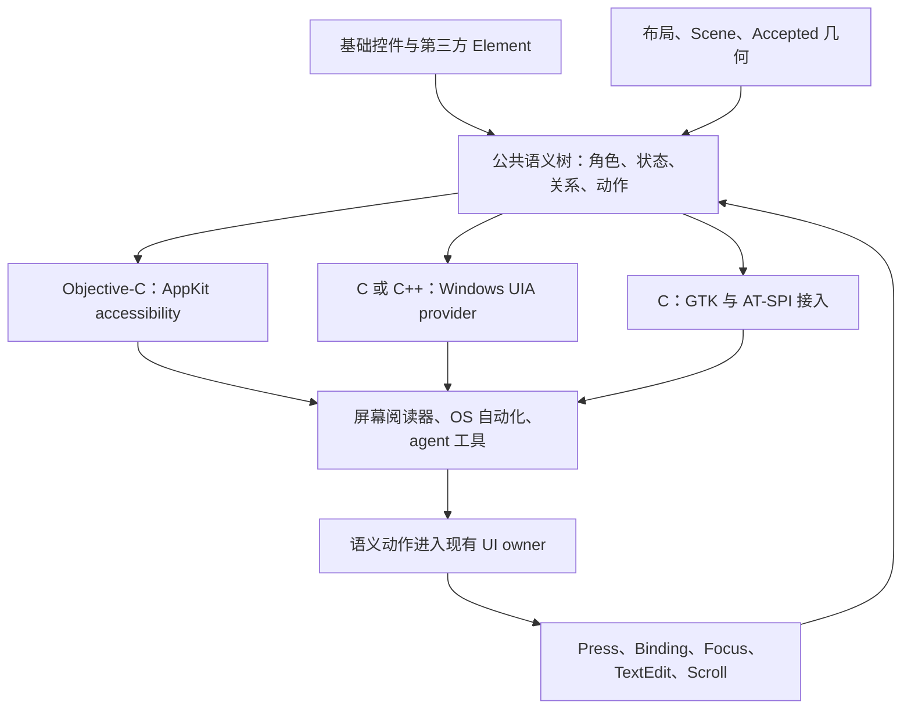

# UI accessibility、UI automation 与 AI computer use 调研

日期：2026-11-09。本文是调研与实施建议，不是已交付 API，也不修改现行 spec。范围以当前桌面 UI 的 macOS、Windows、Linux 后端为主。

具体目标合同、接口形状、线程边界与验收批次见[设计文档](accessibility/DESIGN.md)。本文件保留调研事实与来源，不代表实现已经完成。

2026-11-16 配合 [UI 交互细节打磨](interaction-polish/DESIGN.md)复核了该设计，补充系统偏好、滚动条／回弹、原生文本菜单、拖放与触摸的等价操作及通知要求；完整任务已纳入[统一实施计划](interaction-polish/PLAN.md)。原有平台选型和待实施状态保持；本次源码及平台资料核查的具体发现见交互打磨设计，不把设计更新记为 provider 实机验收。

## 1. 结论与本次约束

建议为 Scoop UI 增加一份平台无关的语义树，通过各平台的原生 provider 同时服务屏幕阅读器、系统辅助操作、UI 自动化和能读取这些接口的 AI agent。语义节点需要描述角色、名称、状态、关系、几何及可执行动作，并随 UI 的实际变化发送通知。

语义树由控件与框架共同提供：控件理解自己的含义，框架负责身份、生命周期、坐标、提交和分发。它不能从 Canvas 绘图命令或 InputArea 树完整推导出来；普通文本、分组和表单关系也需要被访问。

本次采用以下明确约束：

- **App Intents 暂缓，Swift 互操作由用户另行调研。** 官方 `AppIntent` 的核心接口是 Swift 协议，系统发现还依赖编译期生成的元数据；本次核查的文档仅提供 Swift 语言变体。后续可考虑用自制动态 framework 包装 Swift API，并导出 C ABI 函数供 Scoop 调用；本轮不展开这条互操作与打包支线。[Apple AppIntent](https://developer.apple.com/documentation/appintents/appintent)、[App Intents 概览](https://developer.apple.com/documentation/appintents)
- **本期 accessibility 适配按用户决定排除新增 Rust 依赖。** 因此不采用底层由 Rust 实现的 AccessKit，也不安排将其改造成 no_std 的工作。这是当前实施选型，不将既有静态链接的 personality 问题泛化为所有动态封装都不可行。[AccessKit 官方说明](https://github.com/AccessKit/accesskit)
- 原生适配采用当前已有的 **C／Objective-C／C++** 能力；复用系统 API、GTK／GLib、现有 owner 事件循环、文本模型和 GC／callback 边界。
- 本期服务 UI 语义和可操作性，不增加编译器专用 IR、独立授权体系、通用资源预算或应用内 AI 决策框架。

## 2. 仓库现状与真正缺口

| 现有能力 | 可复用部分 | 仍需补齐 |
| --- | --- | --- |
| Component／Element／LazyElement 与挂载树 | 实例身份、Props、State、生命周期 | 独立于绘制和输入的语义声明；一个挂载可产生多个语义节点 |
| SceneContext 与 Accepted 几何发布 | transform、clip、子项放置、Portal、场景缓存 | 对外语义几何及命中测试；失败或 Discarded 的场景不能发布新位置 |
| Press、Binding、公共交互 | 最新回调、禁用、激活规则、受控状态 | 可由原生 provider 发起的语义动作入口 |
| FocusHandle、KeyNavigation、InputBoundary | 键盘焦点、活动项、模态边界、焦点恢复 | 对 AT 暴露焦点与 active descendant；区分屏幕阅读器浏览位置和键盘焦点 |
| TextEditorState、TextEditHost、TextLayout | 正文、选区、composition、历史、文字几何 | accessibility 文本范围、读取、选择、编辑动作和文本变化通知 |
| FieldTarget、FieldLabel、Field | 标签目标、错误、required、description 的已有含义 | labelled-by、described-by、错误信息等可查询的语义关系 |
| VirtualList、ItemSource、按 key 显露 | 数据身份、按需挂载、滚动与焦点请求 | 未实现条目的语义访问、实现／显露请求及活动 AT 目标的保留 |
| macOS 的 SWView／AppKit | Objective-C 原生视图、窗口与文本接入 | 自绘控件的 NSAccessibilityElement 子树 |
| Linux 的 GTK4／libadwaita | GtkGLArea、GObject、GIO、GLib、同一 owner poll | 自绘子树以及 GTK 公共接口未覆盖的自动化操作 |

现行 [UI spec](../specs/SCOOP-UI-SPEC.md) 第 1 节和 [控件基础设计](component-foundations/DESIGN.md) 明确将 accessibility 排除在已交付范围之外；已有真实窗口测试不能作为 OS accessibility 已支持的证据。

本次查看的主要实现入口：

- [挂载节点](../../sysroot/src/scoop.ui/src/runtime/node.scoop)、[SceneContext](../../sysroot/src/scoop.ui/src/layout/scene.scoop)、[Press](../../sysroot/src/scoop.ui/src/interaction/press.scoop)。
- [文本模型](../../sysroot/src/scoop.ui/src/text/editor/state.scoop)、[文本宿主](../../sysroot/src/scoop.ui/src/text/editor/host.scoop)、[macOS 文本快照与 UTF-16 转换](../../sysroot/src/scoop.window/native/darwin/text_snapshot.m)。
- [macOS 窗口对象](../../sysroot/src/scoop.window/native/darwin/window.h)、[Linux 窗口对象](../../sysroot/src/scoop.window/native/linux/window.h)、[窗口 Cone 的 native 依赖](../../sysroot/src/scoop.window/Cone.toml)。
- [Linux GUI 实施记录](../linux-gui/PROGRESS.md)：当前最低运行依赖为 GTK 4.18、libadwaita 1.4；内容经 GtkGLArea 呈现。

## 3. 分清三个访问层次

| 层次 | 访问者需要什么 | 框架应提供什么 |
| --- | --- | --- |
| 无障碍访问 | 理解内容、顺序、状态、关系，并使用辅助操作 | OS 可查询的语义树、动作和变化通知；正常键盘与视觉可访问性 |
| UI 自动化 | 找到元素、读取值、执行动作、等待实际结果 | 稳定身份、可选 automation identifier、原生 pattern／action、真实状态和错误 |
| AI computer use | 从截图或结构化观察理解当前界面，再操作并验证 | 上述公共能力，加上准确的文字、几何、状态和正常鼠标／键盘行为 |

AI 的观察方式并不统一。Anthropic 官方 computer-use 示例展示桌面、截图与输入动作的 agent loop；Microsoft Playwright MCP 则展示通过结构化 accessibility snapshot 操作网页的路线。后者是浏览器实现，不能直接当作原生 Scoop UI 的适配器，但说明了结构化观察的价值。[Anthropic 官方示例](https://github.com/anthropics/claude-quickstarts/tree/main/computer-use-demo)、[Playwright MCP](https://github.com/microsoft/playwright-mcp)

因此，提供 OS accessibility 能改善会读取它的 agent；它不会让一个只接收截图的模型自动获得语义树。具体 agent 的宿主工具仍要实现 AX／UIA／AT-SPI 的读取和动作调用。Scoop 应先做好 provider，agent 侧的封装由实际使用的工具决定。

App Intents 是另一个应用能力入口，描述业务动作与业务实体，通常不要求沿屏幕逐项点击；它不会因控件已有 accessibility role 而自动生成。本轮只记录未来通过 C ABI framework 接入的方向，Swift 互操作与元数据打包另行研究。

## 4. 公共语义模型需要哪些内容

建议在 `scoop.ui` 的公开能力中表达以下信息。以下是能力清单，具体类型与方法需要在实施前写入 spec。

| 能力 | 最低需要表达的内容 | 对当前控件的意义 |
| --- | --- | --- |
| 身份 | 窗口内稳定的语义节点身份；可选的应用指定 automation identifier | 重排不把旧元素引用指向另一项；定位不依赖本地化文案 |
| 角色 | 文本、按钮、输入、复选、单选、范围、列表、表格、菜单、对话框等 | 由控件含义决定，平台可以用角色与能力组合映射 |
| 名称与说明 | accessible name、description／help、当前值、必要的替代文字 | 图标按钮需要明确名称；placeholder 不替代字段标签 |
| 状态 | enabled、readOnly、checked／mixed、selected、expanded、required、invalid、busy | 反映真实 Binding／模型；不能根据颜色猜测 |
| 关系 | label、description、error、controls、active descendant、所属组 | Field、Combobox、Tabs、表格标题能被正确理解 |
| 结构 | 父子、逻辑阅读顺序、分组、合并、忽略、替换子语义 | 一个 Button 内的文字与图标通常合成一个可操作目标 |
| 几何 | 已提交 bounds、变换、裁剪、窗口关联、命中测试、显露能力 | 对应屏幕实际位置，处理缩放、多显示器、滚动与 Portal |
| 动作 | invoke、focus、toggle、select、expand／collapse、set value、scroll／reveal | 声明当前真正可用的操作，交给同一控件行为处理 |
| 文本 | 内容／范围、选区、caret、行与词等边界、位置和文本偏移转换 | 屏幕阅读、选中内容、输入与自动化编辑 |
| 集合 | 总数、位置、层级、行列、按需访问与实现条目 | 虚拟列表、树、DataTable 无需一次构造全部 View |
| 通知 | 结构、名称、状态、值、焦点、文本、选区、必要的 announcement | 让 AT 和自动化客户端观察操作结果 |

需要明确三种不同身份：运行时的语义节点 ID、用于协调或标识数据项的 ViewKey、应用可显式指定的 automation identifier。普通控件的语义身份随实际挂载管理；虚拟列表还需要用容器身份与 item key 定位逻辑条目，使条目不因 View 被回收而变成另一条数据。条目内部真实挂载的控件仍有自己的生命周期。automation identifier 服务应用约定的测试定位，不能把对象地址、数组下标或显示名称当成这些身份的共同来源。

语义树也不等于挂载树：布局容器往往不需要节点；一个自绘图表可能需要多个数据项；一个多 thumb Slider 需要可分别操作的子节点。框架应允许普通第三方 Element 使用同一公开协议完成这些声明。

隐藏、离屏、被裁剪、被模态阻挡、禁用和只读应分别表达。离屏内容仍可能需要被找到并显露；关闭中的 Portal 已取消输入资格，即使还有退出像素，也不能继续接受旧动作。

## 5. 与现有运行机制的连接

### 5.1 更新与查询

语义状态随实际逻辑更新失效，几何随成功接受的场景发布。不能在试测、失败场景或 Discarded 后把临时坐标暴露给 OS；节点卸载或关闭时则应立即使旧动作目标失效，不能等待未来绘制才收尾。

场景缓存命中不能丢掉语义节点和位置登记。语义内容没有变化时复用现有记录；光标闪烁、颜色动画等纯视觉变化不应每帧重建整棵语义树。位置变化按实际需要发布，announcement 不跟随每个动画采样值。

原生 provider 可以持有一份由 UI owner 发布的数据，服务系统查询；它是 UI 状态的投影，不是第二份业务模型。C 字符串、数组和原生对象的生命周期必须明确，原生缓存不能保存未经现有 GC 机制保活的 Scoop 对象地址。

### 5.2 动作与线程

OS 请求进入现有 owner 分发边界，再调用控件的正式行为。Invoke 不需要先伪造一串鼠标 down／up；但它要遵守同一 enabled、模态域、最新回调和对象生命周期规则。

Checkbox／Switch 等操作只能通过原有 Binding 写入。业务 setter 拒绝更新时，provider 必须继续报告实际旧值，不能先改一份 native 镜像再宣称操作完成。文本修改同样沿正式编辑事务、过滤、选区和撤销路径执行。

部分系统查询是同步的，动作完成约定也因平台不同而异。原生回调中不能重入 render／layout，也不能在持有 provider 锁时等待会反向查询 provider 的 UI owner。应分别确定同步查询、请求接受、动作结果和后续通知的边界；每个平台按其 API 返回成功／失败，不用统一的“已排队”代替全部含义。

复用现有 C／Objective-C／C++ 异常处理与 managed callback 规则，不把 Scoop 异常跨越系统 ABI，也不引入新的 Rust 或 Swift 异常运行库。

## 6. 各平台的落地路径

### 6.1 macOS：现有 Objective-C 层直接对接 AppKit

AppKit 的 accessibility 不要求 Swift。官方 `NSAccessibilityProtocol` 和 `NSAccessibilityElement` 文档同时提供 Objective-C 变体；后者就是为没有对应 NSView 的自定义元素准备的。因此可以在现有 SWView 下挂一棵原生语义对象树，继续使用 Scoop 自绘。[NSAccessibilityProtocol](https://developer.apple.com/documentation/appkit/nsaccessibilityprotocol)、[NSAccessibilityElement](https://developer.apple.com/documentation/appkit/nsaccessibilityelement-swift.class)

需要实现：

- 节点的 role／subrole、label、value、enabled、children／parent、frame 与命中测试。
- `accessibilityIdentifier` 等定位信息，以及真实的焦点、选择、展开、范围与文本属性。
- `accessibilityPerformPress` 等动作，连接到 UI owner 的正式控件行为。
- 结构、值、焦点和文本变化后的原生 accessibility 通知。
- 原生窗口、菜单／对话框和自绘子树的连接，避免重复导出同一个原生控件。

Apple 文档中的旧 `NSAccessibility` 非正式 key-based 协议不宜作为新实现的主入口；应以当前 method-based／role-specific API 为准。[Custom Controls](https://developer.apple.com/documentation/appkit/custom-controls)

验收要同时使用 Accessibility Inspector／VoiceOver，以及外部进程通过 `AXUIElement` 查询和执行动作。只看 Inspector 能否列出 Button，还不能证明 focus、press、文字选择和变化通知正确。[AXUIElement](https://developer.apple.com/documentation/applicationservices/axuielement)

### 6.2 Windows：自绘区域的 UI Automation provider

使用系统 COM UIA provider，C 或现有 C++ 工具链均可。典型实现包含 `IRawElementProviderSimple`，以及自绘子树的 `IRawElementProviderFragment`／`IRawElementProviderFragmentRoot`；通过窗口的 `WM_GETOBJECT` 接入 UI Automation。[UIA provider 概览](https://learn.microsoft.com/en-us/windows/win32/winauto/uiauto-providersoverview)、[实现 server-side provider](https://learn.microsoft.com/en-us/windows/win32/winauto/uiauto-serversideprovider)

角色之外必须实现真正的 control patterns，例如：

| 控件能力 | 对应的主要 UIA pattern |
| --- | --- |
| 按钮执行 | Invoke |
| 复选／开关 | Toggle |
| 输入值 | Value |
| Slider 等数值范围 | RangeValue |
| 列表选择 | Selection／SelectionItem |
| 展开内容 | ExpandCollapse |
| 滚动与显露 | Scroll／ScrollItem |
| 阅读、选区与文字范围 | Text／TextRange，按实际编辑能力补充其他接口 |
| 未实现条目的查找与实现 | ItemContainer／VirtualizedItem |

Text pattern 不等于一个通用的任意文本替换 API，编辑能力应映射到平台实际支持的值设置或输入机制。通知、RuntimeId、AutomationId、COM 生命周期和跨线程查询是 provider 实现的一部分。[Control patterns](https://learn.microsoft.com/en-us/windows/win32/winauto/uiauto-controlpatternsoverview)

验收使用 Inspect／Accessibility Insights、Narrator，并用独立客户端读取 pattern 和触发动作。当前 Windows UI 框架尚有自身接入与验收范围，不能把这个调研视为已完成 Windows UI 支持。

### 6.3 Linux：GTK 可复用，但通用自动化有已确认缺口

当前已依赖 GTK4／GLib。`GtkAccessible` 可由 GObject 实现，允许自定义 accessible 父子关系；`GtkAccessibleText` 自 4.14 起提供文本接口，`GtkAccessibleRange` 自 4.10 起提供范围写入接口。可以据此复用部分 C 语义桥接，不必因自绘内容就引入另一套 UI 工具箱。[GtkAccessible](https://docs.gtk.org/gtk4/iface.Accessible.html)、[GtkAccessibleText](https://docs.gtk.org/gtk4/iface.AccessibleText.html)、[GtkAccessibleRange](https://docs.gtk.org/gtk4/iface.AccessibleRange.html)

但不能据此承诺所有自绘节点已经有可操作的 AT-SPI 接口。本次对照项目最低 GTK 4.18，检查了上游 **4.18.6** 的实现：

- `gtk_atspi_get_action_vtable` 给 GTK 特定控件或 GtkWidget 提供动作；普通只实现 GtkAccessible 的 GObject 走到 `NULL`。声明 BUTTON role 不会自动生成可执行动作。[Action 实现](https://github.com/GNOME/gtk/blob/4.18.6/gtk/a11y/gtkatspiaction.c)
- AT-SPI Component 的 `GrabFocus` 明确返回不支持。[Component 实现](https://github.com/GNOME/gtk/blob/4.18.6/gtk/a11y/gtkatspicomponent.c)
- EditableText 选择 GtkEditable 或 GtkTextView 的实现，不能只因声明 GtkAccessibleText 就认为具备完整编辑入口。[EditableText 实现](https://github.com/GNOME/gtk/blob/4.18.6/gtk/a11y/gtkatspieditabletext.c)

这些结论限定于核查的版本；在线 GTK 文档已是更新版本，不能把新增 API 直接当作项目 4.18 基线可用。GTK 还要求一个 accessible 对象的 role 在其生命周期内保持不变；公共语义角色真正改变时，native 对象需要相应重建。[GTK accessibility 概览](https://docs.gtk.org/gtk4/section-accessibility.html)

建议先用一个自绘按钮、一个输入框和一个虚拟列表做 Linux 最小实验，分别验证树、动作、focus、文本选择／修改。若公共 GTK 路线不能闭合，基于现有 GIO／GDBus 实现自绘内容实际所需的 AT-SPI provider，并验证它与 GTK 的窗口、菜单和对话框树如何连接；不能调用 GTK 私有接口或先承诺这一步无成本。实验后选择一条正式实现，避免保留两套同义的生产桥接。

`libatspi` 主要是访问 AT-SPI 的客户端库，不能将链接它等同于实现 provider。[AT-SPI C API](https://gnome.pages.gitlab.gnome.org/at-spi2-core/libatspi/)

Linux 验收分别覆盖 Orca／AT-SPI 读写、X11 和 Wayland。语义动作与全局输入注入是两条通路；在 Wayland 下支持 AT-SPI，不意味着程序可以任意截图桌面或注入全局鼠标。这些操作仍由实际 agent 的桌面工具及系统机制负责。

## 7. 主要工作量在文本、焦点和虚拟化

### 7.1 文本

不能只给 Textarea 暴露一个 value 字符串。需要读取文本范围、移动阅读位置、查询词／行、读取和设置选区、根据位置找字符、取得字符或范围的屏幕矩形，并发送文本与选区变化通知。

复用 `TextEditorState` 的真实文档与 `TextLayout` 的已有查询。Scoop 现有逻辑范围以 UTF-8 偏移表达；Apple 原生字符串使用 UTF-16 范围，其他接口有各自的偏移与文本单元规则。需要显式转换，覆盖组合字符、非 BMP、emoji ZWJ、双向文字和换行；不能拿字节数充当字符数，也不能从屏幕 x 坐标推断逻辑选区。

accessibility 编辑要与真实 composition、过滤、只读和 undo／redo 一致。只读文本依然可能需要阅读和选择；焦点变化不能制造第二个 IME 宿主。现有视觉遮罩不等于安全文本语义，密码类输入不能在 accessibility value、文本范围或额外自动化快照中泄露原文。[现有文本基础合同](component-foundations/TEXT.md)

### 7.2 焦点与模态

键盘焦点、列表活动项、选中值和屏幕阅读器浏览位置是不同事实。Combobox 搜索输入保有 IME 焦点时，候选变化应通过 active descendant／选择关系表达，不能为朗读一个选项就把键盘焦点抢走。

Dialog／Drawer 打开和关闭时，语义树必须遵守现有模态输入边界和退出状态；Portal 的视觉位置与逻辑归属需要一起处理。原生 provider 不得通过旧节点绕过已生效的禁用、模态或卸载规则。[现有公共交互与 Portal 合同](component-foundations/INTERACTION.md)

### 7.3 隐藏、离屏与未实例化的条目

这三件事不是同一个 visibility 状态。应分别回答：对象是否属于当前可访问的 UI 内容、它是否在视口内、是否已有实际 UI 实例。列表的语义存在不应以本帧创建了多少 View 或画出了多少像素决定。

#### 7.3.1 不可见原因决定可访问性

| 情况 | 建议的语义处理 | 操作与恢复 |
| --- | --- | --- |
| 应用明确隐藏、已关闭但缓存的面板 | 从当前可访问子树撤下；缓存实例不意味着仍可被用户操作 | 拒绝旧内容动作；由正常打开／显示入口恢复，普通查询不自行取消 hidden |
| 内容仍在当前界面中，只是滚出视口或被容器完全裁剪 | 保留逻辑可访问性，按平台表达 off-screen／非 showing | 可读取已知语义并请求显露；离屏不自动等于 disabled |
| 只有部分内容在视口内 | 保留节点，发布实际几何及裁剪关系 | 是否存在点击点按真实区域判断，不能用 bounds 中心代替命中测试 |
| 折叠的树分支或可展开内容 | 保留父节点、expanded 状态与展开动作；子项是否保留为离屏代理按对应控件和平台合同处理 | 正常展开后访问实际子控件；不能把 collapsed 一律当作已删除 |
| 虚拟条目仍属于集合，但没有 View 实例 | 通过集合访问与按需语义代理表示，不能伪装成已存在的完整控件子树 | 实际需要完整控件能力时实现，必要时显露或聚焦 |
| 数据已删除，或已不属于当前筛选结果 | 从当前集合移除，旧目标不再可用 | 不能拿旧 index 操作现在占据该位置的另一项 |

这里的 hidden 指明确的语义／交互隐藏。透明度、暂时未绘制、KeepAlive 未放置、动画裁剪等不能单独决定是否从语义内容中移除；需要遵守所属控件实际的呈现和输入合同。只忽略装饰容器与隐藏整个语义子树也是不同操作。

Windows 明确区分滚出／折叠后仍属于 UI 模型的 IsOffscreen 对象，以及已经关闭但被应用缓存、根本不应出现在 automation tree 的对象；IsOffscreen 不要求计算其他窗口的遮挡。[UIA IsOffscreen](https://learn.microsoft.com/en-us/windows/win32/winauto/uiauto-automation-element-propids)

#### 7.3.2 虚拟列表需要按需的集合语义

例如一个有十万项、视口内二十项的列表，应保留当前逻辑集合的总数、顺序、稳定 key 和访问能力，同时只维持实际需要的 UI 实例。不能让屏幕阅读器误认为列表总共只有二十项，也不应因开启 accessibility 就主动构造十万个 View 或常驻语义对象。

现有 ItemSource 的 count、keyAt、indexOfKey 可以提供集合基础，但不能从任意 `build(index)` 函数推断尚未构造的控件名称和内部结构。需要为实际使用的列表提供一个可选的、读取同一数据快照的条目语义描述入口，表达可以在构建 View 之前确定的名称、角色、选择／禁用状态等；名称格式化与真实行显示复用同一业务函数。

- 查询某项时，按 key 取得或创建轻量语义代理；不主动为所有项分配代理。
- 数据能直接确定的信息可以返回；需要 render／layout 才能知道的子按钮、复杂正文和精确几何，必须等实际准备后再暴露。
- 没有数据级语义描述时，只提供真实已知的集合／条目能力以及实现入口，不编造名称、完整子树或屏幕坐标。
- 按名称／属性查找只在数据源有对应能力时提供。否则使用逐项访问、正常滚动或明确报告该查找不支持；不能为一个查询偷偷 build 全部条目。UIA 的 FindItemByProperty 允许不支持特定属性时返回 E_INVALIDARG，并支持用 propertyId=0 顺序获取条目。[IItemContainerProvider](https://learn.microsoft.com/en-us/windows/win32/api/uiautomationcore/nf-uiautomationcore-iitemcontainerprovider-finditembyproperty)
- 普通属性读取和集合遍历不应自行滚动、抢焦点或启动页面切换。客户端明确要求枚举大量内容时，查询成本仍与读取量相关；按需提供不能被理解为任意全量枚举都零成本。

尚未从服务端加载的数据与尚未实例化的 View 也应区分。只发布当前真实已知的数量、内容及加载能力；不能以虚构条目补齐未知数据。

#### 7.3.3 查询、实现、显露和聚焦分开

建议采用以下语义边界，而不提前冻结具体 API 名称：

| 操作 | 职责 | 不应顺带发生的副作用 |
| --- | --- | --- |
| 查询条目 | 读取已知语义或取得逻辑条目代理 | 不自动滚动、不聚焦、不运行整个列表的 build |
| 实现条目 | 按实际所需能力准备语义对象及必要的挂载、测量 | 不将“已实现”报告为“已经可见”或“已经聚焦” |
| 显露条目 | 使用正常容器的滚动／显露机制使目标进入视口 | 不直接改写应用的 hidden 状态，不绕过关闭或模态规则 |
| 聚焦／执行动作 | 在具备对应能力后执行正常焦点或控件行为 | 不用仅接收排队请求代替平台要求的完成结果 |

UIA 已将 `VirtualizedItem.Realize` 与 `ScrollItem.ScrollIntoView` 分开；Realize 成功不保证对象已经进入视口。未实现代理只必须具备平台要求的有限能力，其他访问可以报告 element-not-available，调用方再请求实现。[UIA virtualization](https://learn.microsoft.com/en-us/windows/win32/winauto/uiauto-workingwithvirtualizeditems)

对已实例化的离屏控件，不设置一个强制要求 `visible=true` 的通用语义动作门槛。读取、选择或 Invoke 是否可在离屏状态执行，由实际控件与平台合同决定；坐标点击需要真实可用的点击点，焦点／编辑需要时沿正常显露路径处理。enabled、readOnly、模态和生命周期检查始终有效。

Scoop 已有 [VirtualListHandle.scrollToItem／focusItem](../../sysroot/src/scoop.ui.component/src/virtual/handle.scoop)、[LazyFocus](../../sysroot/src/scoop.ui/src/focus/lazy.scoop) 和按 key 的准备流程。显露可复用 scrollToItem，聚焦复用 focusItem；需要再明确一个不抢焦点的条目准备入口，不能把 focusItem 当作所有 accessibility 查询的实现方式。新入口复用已有 LazyChildren／布局机制，避免复制另一套虚拟列表。

精确几何在对应布局与 Accepted 场景发布后才成为当前可操作位置。没有新布局的 KeepAlive 项不能把上次离屏前的位置继续当作当前点击坐标；未实现对象更不能用 extent 估算位置冒充实际 bounds。

#### 7.3.4 身份、保留与通知

逻辑条目按容器和稳定 item key 定位，数组下标只是当前顺序。滚动导致 View 卸载后，轻量条目代理仍可按 key 重新解析；真实删除或容器关闭后报告不可用。条目内部已卸载的具体控件引用应正常失效，不能借用旧对象去操作新挂载中名称碰巧相同的子控件。

普通查询或客户端长期持有原生代理，不应强制保活完整 View。复用现有 pinnedItems 的真实焦点、编辑和活动输入保留规则，为正在完成的实现／显露请求增加必要的临时保留，结束或取消即解除。如果平台能明确报告 AT 当前活动目标，可按该具体活动保留；不能将每次属性访问猜成阅读焦点，更不能永久保留所有曾被访问的项。

滚动、实现、回收、选择和真实删除按平台合同发布对应的属性／结构／活动项通知。语义条目的逻辑身份不随像素进出视口改变；平台可按自己的虚拟化合同增减实际实现的子树，不能将回收误报成业务数据被删除。

#### 7.3.5 平台映射的差异

- **macOS**：AppKit 分别提供 rows、visibleRows，以及按行列查询 cell 的能力；需要按所选角色正确区分逻辑集合与可见部分。语义对象可独立于 NSView 存在，但具体大集合枚举成本仍要在 AX／VoiceOver 下验证。[accessibilityRows](https://developer.apple.com/documentation/appkit/nsaccessibilityprotocol/accessibilityrows())、[accessibilityVisibleRows](https://developer.apple.com/documentation/appkit/nsaccessibilityprotocol/accessibilityvisiblerows())
- **Windows**：使用 ItemContainer／VirtualizedItem／ScrollItem 表达查找、实现和显露，真实控件按 IsOffscreen 等属性表达当前状态，不能假设完整虚拟集合必然全部出现在普通树遍历里。
- **Linux AT-SPI**：VISIBLE 与 SHOWING 有不同含义；大型容器还可按合同使用 MANAGES_DESCENDANTS 与 active-descendant-changed，让客户端不必枚举全部子项。它同时要求正确交付相关通知，不能只设置一个标志就宣称完成虚拟化支持。GTK provider 的实际能力仍须单独验证。[AT-SPI StateType](https://docs.gtk.org/atspi2/enum.StateType.html)

AI 工具因此应允许取得当前可见项以及集合的访问／显露能力，再按任务查询目标；不用把整个大型逻辑集合预先序列化进每一次屏幕快照。若工具只支持截图，则仍需通过正常滚动和展开发现内容。

### 7.4 表格与图表的额外语义

DataTable 应表达行、列、标题、排序及选择。Chart 至少需要图表名称、数据说明及适用的可访问数据项；Canvas 里的线和颜色不能自行成为可阅读的信息。此类语义由对应控件提供，框架不通过反射猜业务模型。

## 8. 对 AI agent 特别有用的约定

1. **可理解的名称和结构。** 按钮有明确名称；表单标签、错误和当前值可关联；不要把整个页面拼成一个超长 label，也不要输出无意义的布局内部节点。
2. **稳定目标与实际能力。** 原生元素身份在重排中保持，销毁后明确失效；当前支持的 action／pattern 可查询。automation identifier 与本地化名称分离。
3. **准确几何。** 窗口、屏幕、逻辑单位和物理像素之间可正确换算；移动窗口、DPI、滚动和裁剪后仍能定位。Wayland 无法取得的全局位置应明确未知，不能伪造屏幕坐标。
4. **可观察结果。** 输入、选择和异步加载有真实状态及通知；“请求被接受”不等于“业务操作已完成”。测试和 agent 应等实际条件，避免依赖固定 sleep 或要求应用进入不存在的全局 idle。
5. **语义操作与截图互补。** 支持原生树的工具可按元素调用；纯视觉工具继续使用真实截图和正常输入。两种方式应作用于同一 UI 状态和业务行为。

首期通常不需要为每个 Scoop 应用内置 MCP server、HTTP 控制端口或另一套 AI 专用语义树。若实际使用的 agent 无法读取 OS 接口，再以明确的消费需求增加外部 adapter；其查找、快照和动作应复用同一语义事实。

诊断可提供显式启用的语义树查看方式，帮助定位名称、关系、bounds 和动作缺失。它用于开发检查；不能以内部快照测试替代真实 OS provider 验收。

## 9. 实施顺序与验收

下表保留调研时的阶段划分；当前任务拆分、依赖与实施状态以[统一实施计划](interaction-polish/PLAN.md)为准。

| 阶段 | 交付范围 | 结束条件 |
| --- | --- | --- |
| A：合同与原生可行性 | 先补公共语义／身份／动作／提交的 spec；macOS provider 最小实验；Linux GTK 动作与文本实验 | 真实外部客户端能找到并操作自绘目标；Linux 正式桥接路线有证据 |
| B：macOS 纵向闭环 | Label、Button、Checkbox、单行 Input、一个滚动容器；名称、状态、基础动作与通知 | VoiceOver 能读和操作表单；AX 客户端能修改值并观察结果 |
| C：现有控件语义覆盖 | Field、Radio、Switch、Slider、Tabs、Menu、Dialog、Popover、Combobox；禁用、模态、active descendant | 第三方 Element 可使用相同公开协议；关键组合无需私有入口 |
| D：文本与大集合 | Textarea／SelectableText、范围与 Unicode、虚拟列表／DataTable，按现有控件补图表语义 | 文本与虚拟化真实操作通过；大列表保持按需挂载与静止停帧 |
| E：Windows／Linux | 将同一公共语义映射到 UIA 和最终选定的 AT-SPI 路线 | 各平台原生客户端和屏幕阅读器分别通过；X11／Wayland 分别记录结果 |
| F：实际 agent 组合 | 至少一种结构化观察工具与一种截图操作工具，完成相同业务场景 | 找到字段、编辑、提交、打开模态、选择虚拟项，均以最终 UI 状态确认 |

基础模型的测试留在所属 Cone；需要外部进程、系统权限或真实桌面的验证使用现有实窗／fixture 组织。正常验收采用 release，复用预编译系统库与共享 cache，不为每个控件重建完整 sysroot。

关键组合至少包括：

- 按钮激活后同步卸载自身；禁用或模态切换后迟到的动作；Binding 拒绝写入。
- 名称／值变化与通知；窗口移动和缩放；嵌套滚动、clip、Portal；Accepted 与 Discarded 的位置发布。
- 文本读取、选区、composition、撤销和只读；中文、组合字符、emoji 与 RTL。
- 列表按 key 重排、按需实现、滚动显露、真实删除；关闭窗口后原生对象与订阅的正常收尾。
- 仅键盘操作，以及所支持平台的字体缩放、对比度、焦点可见性和减少动画；语义桥接不替代这些体验要求。

最需要预留工程量的是完整文本接口、虚拟化、平台线程／对象生命周期，以及 Linux 公共 GTK API 的操作缺口。基础 role／label 映射只是入口，不能用它作为整个任务的估时依据。

## 10. 本次调研的证据边界

本次读取了项目规范、UI／窗口／文本实现和上述官方文档，并针对 Linux 动作缺口核查 GTK 4.18.6 上游源码；没有实现或编译 provider 原型，没有进行 VoiceOver、Narrator、Orca 或 agent 的实机验收。

AI 观察方式以成功读取的 Anthropic 官方示例和 Microsoft Playwright MCP 为例。OpenAI 和部分在线模型 API 文档本次访问受限，因此不据此宣称所有厂商、模型或工具版本均可直接消费 Scoop 的语义树。平台 API 文档也不等于具体屏幕阅读器与 agent 已通过兼容测试。

后续实施应先将实际选定的合同写入相关 UI／Window／Component／文本 spec，再修改实现与调用方；本调研中的能力清单不应被当作当前已经存在的 API。
