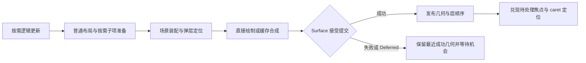

# UI 基础交互能力设计

日期：2026-11-02。状态：设计，尚未实施。本文承接 [UI 总体设计](../DESIGN.md)，以当前源码为基线，覆盖弹层／模态／绝对定位、滚动与两种缓存、焦点导航、快捷键、事件路由、公共文本编辑。文中的新类型和入口均为拟议 API；当前已交付合同仍以相关 spec 和 [UI 实施记录](../PROGRESS.md)为准。

目标是让独立控件库和第三方库用同一套公开协议实现 shadcn/ui 一类控件。Code Block、语法编辑、富文档编辑、手势竞争框架和 accessibility 树不在本次范围；因此完成本文也不等于已达到 shadcn 在浏览器中的全部可访问性能力。现有 UI 验证范围仍是 macOS aarch64 与 x86_64 Rosetta。

## 1. 缺口结论

| 能力 | 当前可复用的部分 | 实际缺口 | 设计 |
| --- | --- | --- | --- |
| 绝对定位、弹出层、模态 | `Stack`、显式子项偏移、Canvas 变换／裁剪、多窗口 | 容器定位策略；跨祖先裁剪的 portal；锚点定位；弹层顺序；输入隔离、焦点约束和恢复。原生窗口模态也没有公开合同 | [LAYERS.md](LAYERS.md) |
| 滚动区域 | clip／translate、带单位和 phase 的 Wheel、主题 Scrollbar 绘图、未放置子树仍保留实例 | ScrollState／滚动条行为／嵌套滚动；绘制缓存；离屏实例保留策略；按需创建和测量的虚拟列表 | [SCROLLING.md](SCROLLING.md) |
| Tab order／key navigation | 单个 InputArea 的可聚焦性、焦点请求、原生键盘信息 | Tab 顺序、焦点作用域、组内箭头导航、滚动显露、虚拟项定位 | [INPUT.md](INPUT.md) |
| shortcut | logical／physical key、修饰键、repeat／synthetic 标记 | 有作用域的绑定、冲突规则、无焦点时入口、编辑器与模态中的优先顺序 | [INPUT.md](INPUT.md) |
| event routing／bubbling | 已有 target → parent 冒泡、按下期间固定路径、取消、命中几何发布 | capture 阶段；传播与默认行为分离；不依赖绘制父子的路由作用域；滚动残量与默认动作 | [INPUT.md](INPUT.md) |
| 公共文本编辑 | 字体排版、grapheme 边界、命中／caret／selection 几何；`TextInputState.apply`、IME 所有权切换 | 可观察编辑状态、完整选择／移动、撤销、剪贴板、编辑控件；原生 surrounding 文本查询 | [TEXT-EDITING.md](TEXT-EDITING.md) |

关键源码依据：

- [MeasureContext](../../../sysroot/src/scoop.ui/src/layout/measure.scoop)要求每个直接子项测量一次；[MountedNode](../../../sysroot/src/scoop.ui/src/runtime/node.scoop)在布局前匹配、挂载整个显式子数组。clip 或不放置不等于虚拟化。
- [PaintContext](../../../sysroot/src/scoop.ui/src/layout/paint.scoop)在绘制时登记 InputArea；[输入场景](../../../sysroot/src/scoop.surface/src/shared/input/scene.scoop)同时保存 Canvas 几何与输入父关系。直接跳过 paint 会丢失本帧区域。
- [指针派发](../../../sysroot/src/scoop.surface/src/shared/input/pointer.scoop)已有冒泡；[焦点派发](../../../sysroot/src/scoop.surface/src/shared/input/focus.scoop)只向当前焦点路径发送键盘事件，没有 Tab 遍历和无焦点快捷键根入口。
- [RenderTarget.snapshot](../../../sysroot/src/scoop.graphics/src/native/target.scoop)明确会把 GPU 目标读回成 CPU 图像，不能直接当作高效 GPU 滚动缓存。
- [TextInputState](../../../sysroot/src/scoop.window/src/text/types.scoop)是纯值事务助手；[DemoEditor](../../../sysroot/src/scoop.surface/examples/basics/src/editor.scoop)是基础接入示例，没有完整编辑器行为。

## 2. 分层与公开能力

| 所属层 | 本次新增或演进的职责 |
| --- | --- |
| `scoop.window` | GUI 纯文本剪贴板；原生输入法文档快照与语义编辑命令；一次性 deadline 的宿主接入；需要独立系统窗口时的原生模态 |
| `scoop.graphics` | 可重放的绘制内容、兼容当前后端的离屏缓存目标及 GPU 内合成；继续负责变换、裁剪、滤镜与图像生命周期 |
| `scoop.graphics.text` | Unicode word 边界、视觉 caret 移动、行间移动所需的布局查询 |
| `scoop.surface` | InputArea／路由作用域、事件阶段、默认动作、焦点会话、输入屏障；画面与几何的提交边界。直接使用 Canvas 的程序也能使用这些能力 |
| `scoop.ui` | 挂载身份与逻辑作用域的接入；场景装配；portal／anchor；按需子项协议；绘制缓存边界；焦点显露与生命周期。`scoop.ui.text` 提供无皮肤的编辑适配 |
| `scoop.ui.component` | Absolute／ScrollArea／VirtualList 等容器策略，Dialog／Popover／Menu 等交互组合，Input／Textarea 的语义和外观 |
| `scoop.ui.style` 及主题 | 边框、背景、焦点环、选择、滚动条等几何／颜色／绘图参数；不负责事件或编辑状态 |

不新增语言语法、编译器阶段、runtime 机制，也不通过内置控件名称分派行为。表中的框架入口必须能由独立第三方 Cone 调用；本次只为实际控件补足能力，不建立通用插件、命令总线或可替换渲染框架。

## 3. 共同基础：逻辑归属与显示位置分开

保留唯一的挂载树。key、Props／State、生命周期、资源、参与事件路由的逻辑祖先，都由这棵树决定。portal 只改变显示位置，不搬迁组件身份，不复制子树。

显示阶段保存布局偏移、额外 transform／clip、层顺序、绘制内容与命中区域。绘制顺序决定最前面的命中目标；找到目标以后沿逻辑路由派发，不沿背后的重叠兄弟继续寻找处理器。普通 `zIndex` 只影响同层显示次序，不改变 Tab 顺序或 key。

锚点、焦点和输入作用域使用有明确窗口及挂载归属的引用对象，例如 `LayoutAnchor`、`FocusHandle`，不暴露 Component 实例反射或用字符串在全树查找。引用卸载时解绑；同一引用不能同时绑定两个活动目标。跨窗口引用报告普通参数／状态错误。

## 4. 必须调整的帧协议

### 4.1 场景装配与绘图分开

当前 `paint` 同时负责画图、登记输入、施加子树几何，无法安全跳过。拟将 UI 自绘协议演进为 `measure → scene`，由 `SceneContext` 装配本帧结构，再由框架执行其中的绘图块。直接 Surface painter 仍可使用 `FrameContext.place`，不强迫所有 Canvas 使用者建立 UI 树。

`SceneContext` 提供以下有限操作：

| 操作概念 | 合同 |
| --- | --- |
| transform／clip／layer | 为本作用域的画面与输入保存同一份几何；组透明度、滤镜顺序仍沿用 graphics 合同 |
| `place(area, shape)`／输入作用域 | 登记区域及逻辑路由；不依赖是否执行实际光栅绘制 |
| `draw(bounds, callback)` | 登记只负责画图的同步块。callback 获得借用 Canvas，不能登记区域、产生子项或修改 State |
| `children(order)` | 按指定显示顺序装配已放置子项，每项至多一次；缺省为描述顺序 |
| anchor／portal | 登记锚点或把已归属的子项放到根部指定显示层 |
| 显式绘制缓存边界 | 为可缓存绘制内容建立失效归属，区域与焦点元数据不进入图像缓存 |

这是对当前有限自绘协议的演进，不增加通用场景查询或渲染插件。影响子项／InputArea 的 transform、clip 必须通过 SceneContext 声明；纯绘图块内仍可自由使用 Canvas，但其中变换只作用于该块的像素。由同一场景记录重放绘图并导出命中几何，不让控件手写两套坐标计算。

`scene` 与 draw 同样禁止 State 写入和启动任务。布局缓存仍由元素所有。旧 `PaintContext.place／paintChildren` 调用方在实施批次中直接迁移，不增加长期并存的旧、新协议。场景记录在本帧内建立并消费，不保存借用 Canvas；跨帧缓存只持有明确拥有的不可变绘制内容／图像。

### 4.2 帧与输入发布

Surface 增加与一次实际帧绑定的提交结果通知，供 UiRoot 发布对应锚点、焦点可用性并完成延迟焦点请求。通知在 Canvas 借用和当前绘制回调退出后交付；不在绘制栈里调用任意业务回调。失败不回滚 State，也不能宣布新层已经可交互。

节点关闭／禁用仍可立即收紧输入资格；新区域、解除遮挡后的目标、位置与 clip 变化，按成功帧更新。模态请求在等待首帧期间可以先阻止背景输入，但不能把焦点送到尚未提交的区域，详见 LAYERS。文本内容快照的发布独立于 caret 几何，详见 TEXT-EDITING。

### 4.3 失效与停帧

`ComponentScope` 增加具体节点归属。现有 `requestFrame()` 保持保守语义：本节点的绘制内容失效并使相关祖先缓存失效。新增仅更新呈现位置的请求用于滚动偏移、外部平移和 clip；它仍重建本帧场景，但不无条件作废未改变的子内容。

Props／子结构变化、实际布局结果变化、字体／图像内容变化、主题和 DPI 变化、可见动画采样，使受影响缓存失效。缓存只复用未失效内容，不以逐帧哈希、重画后比较或重复检查绘制过程决定命中。无法精确分类的失效按普通重画处理。

本次不承诺全树增量布局；实际帧仍可测量全部普通子树，虚拟容器只测量本次实现的子项。静止时继续不遍历、不绘制、不提交。离屏保留项的动画不单独维持窗口帧需求；时间照常推进，重入时采样当前值，必要完成通知可用一次性 deadline 交付，不改成逐帧唤醒。

离屏保留项的 State／Props 更新照常执行逻辑工作并标记其内容失效；只有影响当前可见内容、滚动范围／滚动条或其他真实呈现结果时才请求帧。单纯更新一项仍未呈现的缓存内容，不沿用当前 UiRoot 对任意逻辑工作都请求窗口帧的做法。显式宿主重画、父节点将其重新显露等仍会唤醒正常帧。

caret 闪烁、延迟 Tooltip 和拖选到边缘时的下一次推进需要 owner 归属的一次性 deadline。接入现有 Window 事件循环，与应用 `ControlFlow` 和其他 deadline 合并取最近时间；不覆盖应用等待策略，不增开循环或常驻计时线程。关闭／失焦时取消；只有实际到期行为需要显示变化才请求帧。

## 5. 实施顺序与完成条件

每批先修订对应公开 spec，再迁移实现、现有调用方和必要测试。本次只提交设计与文档入口，不将未实现行为写成已交付合同。

| 批次 | 范围 | 能实际交付的结果 |
| --- | --- | --- |
| A | 场景／输入几何分离，路由作用域，capture／bubble／default，提交通知 | 现有 Button／Checkbox／Style／段落／示例迁移后行为相同；绘图块跳过时输入仍有效 |
| B | FocusHandle／FocusScope、Tab、组内导航、ShortcutScope、焦点显露协议 | 可只用键盘完成表单，组内箭头导航，与无焦点窗口快捷键；模态隔离有共同基础 |
| C | Absolute、portal／anchor、同窗口模态、关闭与恢复规则 | Dialog／AlertDialog／Sheet 的基础交互；Popover／Menu／Tooltip 的定位与关闭基础 |
| D | 普通 ScrollArea、嵌套残量、按需子项、固定／可变高度 VirtualList、实例缓存 | 不依赖绘制缓存就能交付正确滚动；虚拟列表实例与数据量解耦，焦点可定位到未挂载项 |
| E | 可缓存绘制内容、GPU 离屏目标、分块绘制缓存 | 缓存命中减少绘制／光栅工作，滚动时区域、阴影和 DPI 仍正确；四种缓存组合均可用 |
| F | 公共编辑状态／适配、Unicode 导航、剪贴板、IME 文档快照、Input／Textarea | 输入、选择、撤销、组合输入、滚动显露和快捷键形成完整编辑闭环 |

F 中纯编辑事务、Unicode 查询和 Window 剪贴板可以提前开展；最终集成依赖 B、D，不必等待 E。独立原生窗口模态在确需系统 sheet／独立窗口弹层时按 LAYERS 实施，不作为普通 Dialog 的前置。不以这一批为理由扩大到 Drawer 手势、完整 Command 搜索器、日历或 Data Table 数据模型。

spec 更新位置：

| 文档 | 对应合同 |
| --- | --- |
| [UI](../../specs/SCOOP-UI-SPEC.md) §2、§5–8 | scene 协议、按需子项准备、逻辑／显示归属、scope 失效、焦点与缓存生命周期 |
| [Surface](../../specs/SCOOP-SURFACE-SPEC.md) | 路由、默认动作、焦点和模态输入屏障、成功帧通知、可见性与动画需求 |
| [Window](../../specs/SCOOP-WINDOW-SPEC.md) §4–5 及循环合同 | GUI 剪贴板、surrounding 快照、语义编辑命令、deadline；独立批次的原生模态 |
| [文本排版](../../specs/SCOOP-GRAPHICS-TEXT-SPEC.md) | word 边界、视觉 caret／行导航；保留 UTF-8 与 affinity 规则 |
| [样式](../../specs/SCOOP-UI-STYLE-SPEC.md)、[图形效果](../../specs/SCOOP-GRAPHICS-EFFECTS-SPEC.md) | 场景迁移、缓存绘制边界与效果扩展；缓存图像不隐式裁剪阴影 |
| [控件库](../../specs/SCOOP-UI-COMPONENT-SPEC.md) | 容器、弹层、组导航、Input／Textarea 的具体属性和行为 |

graphics 基础 Canvas／图像合同当前由 Surface spec 承载，补充绘制记录与兼容离屏目标时同步该文档。语言、runtime、编译产物规范无须因这些普通库能力而改变。

## 6. 验收方式

验证围绕真实控件组合，不为设计中的每个字段复制一套测试框架。普通行为用所属 Cone 的 `scoop.test`；纯值事务、布局结果、派发顺序及挂载计数可以确定性断言。像素缓存用真实 Raster／Metal 对照与必要容差。OS 焦点、AppKit IME、剪贴板、deadline 和真实窗口关闭另做实际宿主覆盖。

| 组合用例 | 必须证明的行为 |
| --- | --- |
| ScrollArea 中的按钮打开 Dialog，再打开 Popover | portal 不受旧 clip 限制；事件沿逻辑祖先；只关闭最上层；背景不能点击／Tab／触发快捷键；关闭后恢复有效焦点 |
| 嵌套滚动区域 | 子区域到边界时只向父交接残量；单位、phase、DPI、两轴和 momentum 保留 |
| 大列表四种缓存组合 | 绘制开／关 × 实例保留／不保留独立；虚拟范围外不创建全部实例；key 变化和淘汰执行真实卸载 |
| 可变高度列表中插入数据与编辑 | 同 key 的阅读位置保持；焦点／拖选／组合输入不中途被缓存淘汰；退出后可正常回收 |
| 缓存命中时滚动、resize、DPI 与主题切换 | 图像与输入位置一致；需要失效时真正重画；阴影／圆角／滤镜无接缝或额外裁剪 |
| Input／Textarea 与模态快捷键 | 中英文 IME、emoji／组合字符、双向文字、选择、粘贴、撤销；编辑快捷键优先，确认组合的 Enter 不顺带提交表单 |
| 无 drawable、失败帧、关闭和静止 | 不发布未提交位置；取消与旧 IME 会话完整收尾；失焦编辑器及离屏动画不维持空帧 |

大列表验收观察实际 build／mount／measure／draw 次数和资源释放，不只比较截图或最终滚动偏移。在正 extent、有限可见密度的用例中，测试数据量增加时，首屏实例数量不应随总行数线性增长；未知的零高度连续项另验证有限推进和资源释放，不承诺无需访问这些项就能得知其尺寸。绘制缓存既要有像素一致性，也要证明命中时没有重新执行昂贵内容绘制。

## 7. 外部参考的使用范围

- [shadcn/ui 组件目录](https://ui.shadcn.com/docs/components)：用于确定组合目标，不能把浏览器／DOM 已有的能力误算成 Scoop 已实现。
- [Radix Dialog](https://www.radix-ui.com/primitives/docs/components/dialog)：参考 portal、初始焦点、焦点约束及关闭恢复的可观察行为；不照搬 DOM 实现。
- [Floating UI computePosition](https://floating-ui.com/docs/computePosition)：参考 anchor、flip／shift 与更新触发；Scoop 采用自身单次子项测量协议。
- [Flutter SliverChildBuilderDelegate](https://api.flutter.dev/flutter/widgets/SliverChildBuilderDelegate-class.html)：lazy 构建、实例保留和绘制边界是不同职责；本文同样把三者分开。
- [Flutter RepaintBoundary](https://api.flutter.dev/flutter/widgets/RepaintBoundary-class.html)、[SkPictureRecorder](https://api.skia.org/classSkPictureRecorder.html)：绘制记录复用不等于像素复用；缓存应显式处理失效、边界和资源所有权。
