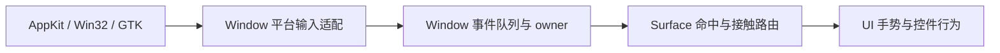

# Window 输入事件边界调研与重构方案

日期：2026-11-17。状态：方案选定，尚未实施。属于 S1 的输入边界整理和 S8 的前置工作；沿原计划先在本地实现与验证，再集中验收其他平台。

## 1. 结论

在 `scoop.window` 内整理平台输入子系统，统一输入事件的含义、载荷和生命周期。各平台继续通过自己的 NSResponder、Win32 消息或 GTK controller 接收事件；公共层消费已经转换完成的输入事实。点击计数是该子系统中鼠标路径的一项职责。

`window-clicks` 当前是 `scoop.tests` 下的测试 Cone，直接编译 Windows 的点击计数函数，并不是运行时输入库。保留它的定向验证用途。生产实现放在 Window 内部的 input 模块；既有 Application 事件循环、队列和 owner 继续承担调度。

触摸接入分为三层：Window 提供原生接触与手势事实，Surface 按 contact 维护命中、路由和归属，UI 识别原始触摸的 tap／long press／pan 等操作。系统已经识别的触控板手势直接转交，不再次用同一输入合成一套识别结果。

## 2. 现状与具体问题

| 位置 | 当前职责 | 对重构的影响 |
| --- | --- | --- |
| [window-clicks](../../../sysroot/src/scoop.window/tests-cones/clicks/Cone.toml)、[clicks.h](../../../sysroot/src/scoop.window/native/windows/clicks.h) | 六组纯计数测试；Windows 鼠标的时间、屏幕位置、按钮及取消历史 | 算法保持平台局部，AppKit／GTK 继续采用原生 count |
| [Darwin pointer.m](../../../sysroot/src/scoop.window/native/darwin/pointer.m)、[keyboard.m](../../../sysroot/src/scoop.window/native/darwin/keyboard.m) | NSResponder 回调、坐标、按钮状态、滚动相位、键盘／IME 配合 | 入口已自然分开；需要一致的内部载荷与状态归属 |
| [Windows input.c](../../../sysroot/src/scoop.window/native/windows/input.c) | 一个 switch 内处理键盘、鼠标、滚轮、捕获、光标及点击计数 | 接入 WM_POINTER 前按实际输入种类拆分；保留 DefWindowProc 的必要处理 |
| [Linux input.c](../../../sysroot/src/scoop.window/native/linux/input.c) | controller 安装、GTK 回调、按键、点击、滚动、失焦清理和载荷构造 | 分开 controller 生命周期、输入转换和状态；原生 sequence 与 Surface 归属各守一层 |
| 三平台 `window.h` 与 [native/abi.scoop](../../../sysroot/src/scoop.window/src/native/abi.scoop) | 重复定义 SWEventData；输入用 a／b／c／flags 表达多种含义 | 输入种类、相位和有名字段应在明确的公共 native 边界定义 |
| [native/events.scoop](../../../sysroot/src/scoop.window/src/native/events.scoop) | 把 native 载荷转换为公共事件；滚动相位按 AppKit 位值解码 | 公共解码不应依赖某一平台的原生枚举 |
| [frame/operations.scoop](../../../sysroot/src/scoop.window/src/frame/operations.scoop) | 同时保存系统窗口操作和 NativeInputDelivery 的寿命 | 原生输入附件移入 input 内部；窗口移动、resize 和数据拖放继续消费同一附件 |
| [Surface InputRouter](../../../sysroot/src/scoop.surface/src/shared/input/router.scoop) | 当前只有一份 pointer／pressed／pointerClaim | 鼠标聚合模型之外，需要按触点分别保存接触路径和归属 |

相位转换已有一个可从源码确认的不一致。GTK 回调把 begin／scroll／end 分别写成 detail 0／1／2，`sw_pointer` 原样写入 `data.a`；公共 `scrollPhase` 却把它当 NSEventPhase 位值：

| GTK 路径 | 当前写入 | 公共层读出的结果 | 应表达 |
| --- | --- | --- | --- |
| scroll-begin | 0 | None | Began |
| 连续 scroll | 1 | Began | Changed |
| scroll-end | 2 | Stationary | Ended |
| 传统 wheel 的 scroll | 1 | Began | 无原生相位时为 None |

第一批应修复这种转换约定问题，增加实际生产转换函数的定向覆盖。源码核对不代替 GTK 实际输入验收，也不把本地计数测试视作 Windows 输入链已经通过。

## 3. 方案比较

| 方案 | 判断 |
| --- | --- |
| 扩大 `window-clicks`，让它成为所有系统输入的生产库 | 现有对象是测试 Cone，名称与职责也过窄；需要重新划分 Window 依赖，却不能减少平台回调差异 |
| 在 Window 内整理 input 子系统，保留平台入口、统一内部事件合同 | 采用；可以沿现有 owner、原生事件附件及 IME／拖放实现逐批迁移，直接解决相位、状态和触点接入问题 |
| 引入新的通用窗口／输入后端替换现有接入 | 当前收益不足；已经接入的原生窗口、菜单、文本服务、拖放和 accessibility 都依赖现有平台宿主，替换成本超出这次输入边界整理 |

暂不把输入抽成独立公共 Cone。现在只有 Window 使用这些原生采集入口，生命周期又依赖真实窗口与应用循环；内部模块已能建立必要边界。

## 4. 职责与代码组织

### Window 平台输入适配

将同一平台的鼠标、键盘、触摸、原生手势及输入状态放在 `native/<platform>/input/` 附近的明确模块中。按当前实际职责拆文件，不为了目录对称新增空实现。平台类型、系统枚举和消息处理返回值留在这一层。

- 鼠标负责位置、进入／离开、按钮、连续次数、滚轮和平台捕获；Windows 的 clicks 算法由其调用。
- 键盘与现有文本服务协作，保留菜单快捷键、IME 消费与普通 Keyboard／TextInput 的顺序。输入子系统统一协调，IME 文档事务仍由专门模块维护。
- 触摸／笔负责 contact 生命周期、实际位置、来源及系统确实提供的可选数据；设备身份未知时保留未知。
- 原生手势负责 phase、位置、增量／累计量的明确转换。滚动与 momentum 保持独立相位。
- 平台输入状态统一拥有按下记录、controller／tracking 资源和原生捕获。失焦、模态、系统接管、关窗走明确的取消与释放入口；单触点取消与全窗口取消分开。

应用／窗口的一般事件循环、resize、redraw、显示器变化仍由 Application／Window 管理。Win32 的 frame／menu／text／input 处理次序、NSResponder 传播以及 GTK 的系统级 sequence 规则继续保留，输入适配器不得吞掉原生默认行为。

### Window 公共内部边界

把输入 kind、phase、取消原因和载荷定义集中到共享 native 头与对应 Scoop `@CLayout` 声明。鼠标／滚轮、键盘、接触和原生手势使用含义明确的字段；新 touch／gesture 不再借用未命名的 a／b／c 槽位。

公共解码只处理 Scoop 定义的枚举与单位，不解读 NSEventPhase、GDK 枚举或 WM_*。逻辑坐标、物理坐标、滚动单位与时间来源在平台边界确定；仍无法取得发生时刻时使用现有 InputTime.Observed，不伪造时钟精度。

NativeInputDelivery 及其复制／释放移动到 input 内部，保留原事件队列和 owner 的交付时序。普通事件载荷在 native owner 释放前复制；移动窗口、系统菜单和数据拖放所需的原生事件附件保留到既有交付／准备边界。无需新增事件循环、插件注册、公共原生指针或第二份输入状态。

### Surface 与 UI

Surface 延续最近 Accepted 几何、Capture／Target／Bubble、模态边界及 claim 机制。鼠标维持既有聚合按钮行为；触摸按 contact 保存起始路径、当前位置与当前归属，支持独立取消和窗口级统一取消。接触结束前目标卸载、路径失效或系统接管都有终止出口。

UI 在这些事实和路由上组合 tap、long press、pan、pinch／rotate 等实际需要的识别。滚动、按压、文本选区和 Slider 对同一接触的竞争在这里协调；Window 不决定哪个控件赢得手势。原生 gesture 与从原始触摸识别的 gesture 进入相同的控件行为入口，并保留来源，防止重复消费。

## 5. 各平台接入选择

| 平台 | 选择 | 需要守住的边界 |
| --- | --- | --- |
| macOS | 保留鼠标／键盘 NSResponder 回调；增加 magnifyWithEvent／rotateWithEvent／swipeWithEvent 等实际原生手势入口 | 触控板手势与直接触屏不同；滚动 phase 与 momentumPhase 分开。原始 NSTouch 的设备位置不能冒充窗口内容中的触摸坐标 |
| Windows | 普通鼠标保留现有 WM_MOUSE*；触摸／笔沿 WM_POINTER* 及对应查询取得信息，处理每个 pointer 的捕获与取消 | 明确处理与默认处理的边界；关联兼容鼠标消息，既避免重复点击，又保留 OLE 从合成鼠标消息启动拖放所需的原生上下文 |
| GTK 4 | 鼠标继续使用 GtkGestureClick 的计数；直接触摸沿 GdkTouchEvent／GdkEventSequence；原生触控板使用 GdkTouchpadEvent 的 phase／delta | GtkGestureClick 本身也可能处理触摸，需在输入适配边界确定单一交付路径。GTK 原生 sequence 的传播与 UI 控件间的 claim 分层处理 |

Windows 当前来源可通过 GetCurrentInputMessageSource 查询，但不可用值不能被猜成真实设备；具体去重必须结合正在接收的原生消息和接触生命周期。Windows 触控板没有提供独立手势事实的路径继续按实际滚轮输入处理，不从普通滚轮臆造完整 contact。

## 6. 实施顺序与验收

1. **先规范与输入编码。** 更新 Window spec 的内部转换边界；统一输入枚举／载荷，修正 GTK 相位转换。保留现有公共鼠标 API，增加生产转换代码的定向测试。
2. **整理平台输入状态与寿命。** 按实际职责拆分 Windows／GTK 输入模块，协调 Darwin 的已有 pointer／keyboard 入口；迁移 NativeInputDelivery 归属。复用已有点击、按键、IME、取消、模态、窗口操作和文本拖放回归。
3. **再增加 contact 与原生 gesture。** 先定义真实能力、参数单位、source、结束／取消及兼容鼠标规则，再实现平台接入与公共事件。macOS 验证触控板；Windows／Linux 的直接触摸按原计划在相应设备集中验收。
4. **完成 Surface 路由与 UI 识别。** 按 contact 维护路径和 claim，再接入触摸滚动、长按菜单、文本端点、缩放／旋转等 S8 消费者。S9 只在缺少原生 momentum 的直接触摸路径增加需要的软件惯性。

测试保持现有层次：纯转换与计数使用必要的 Cone 测试；真实平台输入使用原生入口；多击选择、滚动、拖放和 IME 使用既有消费者回归。真实触屏、触控板与鼠标分别记录，跨平台结果不互相代替。无需为整理代码建立完整 OS API 模拟层或逐批执行全仓／远程测试。

## 7. 核查依据

- 本文链接的仓库源码，以及 [Window spec](../../specs/SCOOP-WINDOW-SPEC.md)、[交互设计](DESIGN.md)的第 3／7 节和 [S1／S8 计划](PLAN.md)。
- Apple [Handling Multi-Touch Events](https://developer.apple.com/library/archive/documentation/Cocoa/Conceptual/EventOverview/HandlingTouchEvents/HandlingTouchEvents.html)：NSResponder 手势入口、触摸与手势的区别、取消、滚动与 momentum。
- Microsoft [WM_POINTERDOWN](https://learn.microsoft.com/en-us/windows/win32/inputmsg/wm-pointerdown)、[GetCurrentInputMessageSource](https://learn.microsoft.com/en-us/windows/win32/api/winuser/nf-winuser-getcurrentinputmessagesource) 和 [DoDragDrop](https://learn.microsoft.com/en-us/windows/win32/api/ole2/nf-ole2-dodragdrop)：指针接触／捕获、来源读取和触摸／笔的 OLE 启动限制。
- GTK [GdkTouchEvent](https://docs.gtk.org/gdk4/class.TouchEvent.html)、[GdkTouchpadEvent](https://docs.gtk.org/gdk4/class.TouchpadEvent.html) 和 [GtkGesture](https://docs.gtk.org/gtk4/class.Gesture.html)：接触 sequence、兼容指针信息、系统识别的触控板手势及传播／claim 规则。

本次完成源码和官方文档调研，未实施重构，也未新增设备验收结果。
